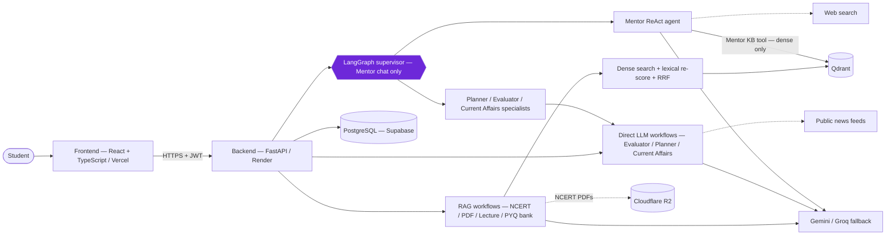
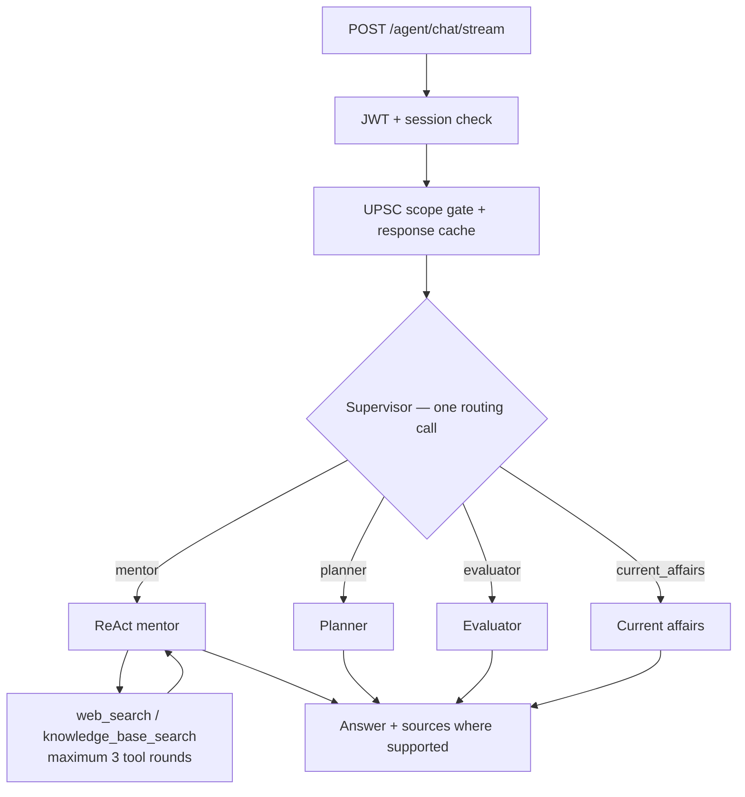
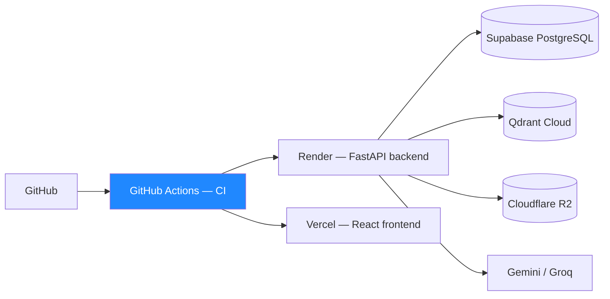

<div align="center">

# UPSC AI Pro

**A full-stack, AI-powered UPSC learning platform with eight study workflows.**

Built as an end-to-end engineering project — FastAPI + LangGraph backend, React/TypeScript frontend, retrieval-augmented generation, security controls, automated tests and cloud deployment.

[](https://upsc-ai-pro.vercel.app/)
[](https://upsc-ai-pro-puih.onrender.com/docs)
[](https://upsc-ai-pro-puih.onrender.com/health)


</div>

> **Reviewer TL;DR** — Eight UPSC study workflows in one application; a LangGraph supervisor and ReAct agent for **Mentor chat only**; retrieval over curated content, NCERTs, uploaded PDFs, lectures and a personal PYQ bank; isolation of user-owned data across storage and checkpoints; Gemini → Groq fallback and recoverable jobs. The author's working tree collected **1,847 offline test cases**, including an unpublished test file; this is not a passing count for the published branch. Retrieval and safety evaluations have important limitations described below.

> **Free-tier note:** The backend may sleep when idle, so the first request after a pause can be slow. The links above were provided by the project owner; their current availability is not verified here.

---

## Table of Contents

1. [Problem Statement](#1-problem-statement)
2. [System Design](#2-system-design)
3. [Engineering Decisions](#3-engineering-decisions)
4. [Engineering Features](#4-engineering-features)
5. [Performance & Reliability Metrics](#5-performance--reliability-metrics)
6. [Failures, Limitations & Lessons](#6-failures-limitations--lessons)
7. [Screenshots](#7-screenshots)
8. [Local Setup & Tests](#8-local-setup--tests)
9. [For Reviewers & Recruiters](#9-for-reviewers--recruiters)
10. [Documentation](#10-documentation)

---

## 1. Problem Statement

**User problem.** UPSC preparation spans a large syllabus, varied sources and extended periods of study. Aspirants need to navigate NCERT chapters, previous-year questions, current affairs and their own documents while also planning study and practising answers.

**Why a general chatbot alone is insufficient.** It can produce confident but incorrect answers, may not provide sources, and does not naturally keep a student's documents and preparation workflows together. A study platform also needs boundaries around user data, predictable failure handling and testable backend behaviour.

**The approach.** UPSC AI Pro brings eight workflows into one application and uses retrieval where the workflow supports it. Mentor chat routes requests with a LangGraph supervisor and can call web and knowledge-base tools; the other seven workflows use their own feature functions. Sources and citations differ by workflow and are **not claim-level verification**.

See [Product Overview](docs/PRODUCT_OVERVIEW.md) and [Workflows](docs/WORKFLOWS.md).

### Eight Study Workflows

| # | Workflow | Backend route | Implementation |
|---|---|---|---|
| 1 | **AI Mentor** | `POST /agent/chat/stream` | LangGraph supervisor + ReAct agent |
| 2 | **NCERT Study** | `/ncert/*` | Feature functions + RAG |
| 3 | **PYQ + Personal PYQ Bank** | `/pyq/*` | Feature functions + RAG + job |
| 4 | **Answer Evaluator** | `/evaluator/*/sync` | Feature functions |
| 5 | **Current Affairs** | `/current-affairs/*` | Feature functions + public feeds |
| 6 | **Study Planner** | `/planner/*` | Feature functions + saved plan |
| 7 | **Lecture Learning** | `/lecture/*` | Feature functions + RAG + job |
| 8 | **PDF / Document Chat** | `/upload/*` | Feature functions + RAG + job |

> **Architecture distinction:** Eight workflows does **not** mean eight LangGraph agents. Only Mentor chat uses the supervisor; the other seven invoke feature functions directly. The four RAG workflows use the full retrieval pipeline; Mentor searches its curated KB through a separate dense-only tool.

---

## 2. System Design

### High-Level Architecture



### Mentor Request Flow



The Mentor knowledge-base tool searches only the **curated Mentor KB**, using dense retrieval rather than the full RAG pipeline; the model cannot choose a user's collection. Despite the route name, Mentor replies currently arrive whole rather than token by token. See [Agent Architecture](docs/AGENT_ARCHITECTURE.md).

### RAG Architecture

| Stage | Implementation | Boundary / tradeoff |
|---|---|---|
| **Content** | NCERT chapters, user PDFs, lecture transcripts, personal PYQs and a curated Mentor KB | User uploads, pasted lectures and PYQ banks are owner-scoped; NCERT, YouTube transcripts and the Mentor KB are shared curated collections |
| **Embeddings** | Google `gemini-embedding-001`, 768 dimensions | Embedding calls depend on the provider |
| **Vector store** | Qdrant | Required for retrieval workflows; no working Qdrant fallback is documented |
| **Retrieval** | The four RAG workflows use dense retrieval, then lexical re-scoring of the **same candidates** | No separate BM25 index; lexical re-scoring cannot recover candidates absent from the dense result set. Mentor KB uses dense search only |
| **Fusion** | Reciprocal Rank Fusion, `k = 60` | Rank fusion does not by itself establish answer quality |
| **Threshold** | Similarity threshold `0.3`; Mentor KB `0.25` | On the small offline benchmark, unanswerable queries still retrieved context |
| **Citations** | Mentor “Sources used” and NCERT `[S#]` tags | NCERT validation checks tag format, not whether a source supports a claim; other workflows lack structured citations |
| **Optional techniques** | Cross-encoder reranking, HyDE and multi-query are implemented | Disabled; not part of the documented active retrieval path |

See [RAG and Retrieval](docs/RAG_AND_RETRIEVAL.md) and [Evaluation](docs/EVALUATION.md).

### Background Processing

PYQ, lecture and upload workflows include background jobs. The reliability layer uses heartbeat-leased, recoverable jobs; jobs are **not resumable**. This separates supported processing work from the immediate request path without claiming that in-progress work survives every failure. See [Architecture](docs/ARCHITECTURE.md).

### Security & User Isolation

- **Authentication:** JWT access tokens with a per-request session check; refresh tokens are hashed and rotated. Passwords use bcrypt.
- **Ownership boundaries:** object-level authorization for user-owned data across database, vector-store, checkpoint and cache boundaries. NCERT, YouTube lecture transcripts and the Mentor KB are shared curated collections, not owner-scoped.
- **Input safety:** byte-counted upload limits; untrusted content is fenced; a deterministic UPSC-only scope gate is applied.
- **API hardening:** rate limits, security headers, explicit CORS and fixed error messages.
- **Known risks:** tokens remain in browser `localStorage`, account enumeration is a known concern, and no production backup has yet been taken. See [Security](docs/SECURITY.md).

### Reliability, Observability & Deployment

- **Provider fallback:** Gemini → Groq; timeouts and a circuit breaker address upstream failures. This is not a guarantee that every dependency fails open.
- **Rate limits and cache:** optional Upstash Redis support for shared rate limits and caching; activation is not confirmed in the supplied project documentation.
- **Observability:** Langfuse tracing and Sentry error capture are optional; Sentry is implemented but no DSN is configured in the documented state.
- **Deployment:** Vercel serves the SPA; Render runs the backend; Supabase PostgreSQL, Qdrant Cloud and Cloudflare R2 are external services. Secrets belong in platform dashboards, not the repository.



The diagram describes the architecture, not proof of automated deployment from every CI run. More: [Deployment](docs/DEPLOYMENT.md).

---

## 3. Engineering Decisions

<details open>
<summary><b>Why FastAPI and typed contracts?</b></summary>

**Need:** An API for authentication, study workflows and integrations with typed inputs and outputs.<br>
**Approach:** FastAPI with Pydantic v2, SQLAlchemy and Alembic.<br>
**Tradeoff:** Integrations and asynchronous execution still require careful testing; typed contracts do not validate the factual accuracy of AI output.
</details>

<details>
<summary><b>Why use LangGraph for Mentor routing only?</b></summary>

**Need:** Mentor chat can route between specialist paths and use tools, while other workflows have more direct entry points.<br>
**Approach:** A supervisor routes Mentor messages; a ReAct agent can use web and curated knowledge-base tools with a three-round cap. The other workflows call feature functions.<br>
**Tradeoff:** The application has multiple orchestration styles; the eight workflows must not be described as eight LangGraph agents.
</details>

<details>
<summary><b>Why dense retrieval plus lexical re-scoring?</b></summary>

**Need:** Retrieve relevant study material while accounting for specific terms.<br>
**Approach:** Dense retrieval from Qdrant, lexical re-scoring of those candidates, then RRF and thresholding.<br>
**Tradeoff:** The lexical step only re-scores existing dense candidates; there is no independent BM25 retrieval arm. Thresholds have not reliably rejected unanswerable queries in the documented benchmark.
</details>

<details>
<summary><b>Why isolate user data at multiple boundaries?</b></summary>

**Need:** Documents, saved state and conversations are user-specific.<br>
**Approach:** Object-level authorization covers database, vector, checkpoint and cache boundaries.<br>
**Tradeoff:** Access checks must stay consistent as new features and storage paths are added; tests are not a guarantee against every leakage scenario.
</details>

<details>
<summary><b>Why retain provider fallback and background jobs?</b></summary>

**Need:** LLM services can fail, and document or lecture processing can take longer than an interactive request.<br>
**Approach:** Gemini → Groq fallback, timeouts, a circuit breaker and heartbeat-leased recoverable jobs.<br>
**Tradeoff:** Fallback depends on provider availability and configuration; jobs are not resumable, and Qdrant has no working fallback in the documented state.
</details>

---

## 4. Engineering Features

| Feature | Implementation / evidence | Scope |
|---|---|---|
| **Mentor routing** | LangGraph supervisor + ReAct agent; max three tool rounds | Mentor endpoint only |
| **RAG** | Qdrant, Gemini embeddings, lexical re-scoring and RRF for four workflows; Mentor KB uses dense search | Workflow-specific; no BM25 or active cross-encoder |
| **User isolation** | Authorization across DB, vector, checkpoint and cache boundaries | Controls described in [Security](docs/SECURITY.md) |
| **Authentication** | JWT, per-request session checks, hashed rotating refresh tokens, bcrypt | Tokens in browser storage remain a risk |
| **Safety** | Prompt fencing and deterministic UPSC scope gate | No live-model safety test documented |
| **Background jobs** | Heartbeat-leased, recoverable jobs | Not resumable |
| **Reliability** | Gemini → Groq fallback, timeouts, circuit breaker and rate limiting | No Qdrant fallback documented |
| **CI & testing** | GitHub Actions CI; mocked offline suite | Collected count is not a fresh passing result; lint and prettier are non-blocking, and live smoke is disabled in the documented state |
| **Deployment** | Vercel, Render, Supabase, Qdrant Cloud and R2 | Free-tier backend may sleep |

---

## 5. Performance & Reliability Metrics

> Numbers below are those recorded in the supplied project documentation, measured on **2026-11-05 on a working tree with uncommitted, unpublished changes** unless otherwise noted; the published branch can differ. They are not independent verification or production benchmarks. See [Engineering Metrics](docs/ENGINEERING_METRICS.md) for methods and qualifications.

| Metric | Recorded value | Qualification |
|---|---|---|
| Registered REST operations | **54** under `/api/v1` | Generated OpenAPI schema |
| Backend size | **113 Python modules; 20,185 physical lines** | Excludes `src/eval`; physical lines, not SLOC |
| Frontend size | **44 TS/TSX files; 7,663 physical lines** | Physical lines |
| Offline tests | **1,847 collected cases** | Mocked services; includes an unpublished test file and was not measured for the published branch. Collected, **not re-run** for the documentation measurement |
| Last recorded full test run | **1,765 passed / 2 skipped** | Phase 08 close; separate from the later collection count |
| Database migrations | **6 Alembic migrations** | Recorded project metric |
| Routing fix | **160/200 → 0/200 misrouted** | Scripted stub models; not production traffic or live-model performance |
| Request-path benchmark | **≈13× in one scenario** | Synthetic, local, single worker; not a general speedup claim |
| Retrieval benchmark | **97 queries across four small corpora** | Mostly synthetic; AI-written labels. Not production-quality evidence |
| Unanswerable retrieval | **13/13 retrieved context** | Offline benchmark limitation, not a production rate |
| Safety evaluation | **21 prompt-construction defects found and fixed** | Scripted models; no live-model safety test yet |

No production latency, traffic, cost, user counts or hallucination-reduction figures are claimed. The test commands are listed in [Local Setup & Tests](#8-local-setup--tests).

**CI judge gate:** A nightly/manual LLM-as-judge job is defined, but it targets a CRAG graph not served by an HTTP route, requires secrets and is not a per-commit gate. The three-case sample report has **unverified provenance** and is not evidence of production faithfulness. See [Evaluation](docs/EVALUATION.md).

---

## 6. Failures, Limitations & Lessons

- **Routing defect:** The first message’s saved route was reused for subsequent messages; routing is now recomputed per message. The scripted-stub evaluation went from 160/200 misrouted to 0/200. This is regression evidence for that test, not a live-model error rate.
- **Embedding dimensions:** The SDK ignored an embedding dimension argument, producing 3,072-dimensional vectors against a 768-dimensional collection. A wrapper now requests the dimension, truncates and normalises the output.
- **Blocking request handlers:** A recorded fix moved 18 blocking handlers to plain `def`; a synthetic, local, single-worker benchmark with a fake LLM and auth reported roughly 13× throughput in one scenario—not a production performance result.
- **Unanswerable retrieval:** All 13 unanswerable benchmark queries still retrieved context. A threshold alone is not enough to establish that a question is answerable; calibration on a larger, independently labelled dataset remains future work.
- **Citation boundaries:** NCERT tag validation checks format, not whether each claim is supported. Mentor and NCERT use different citation mechanisms; other workflows have no structured citations.
- **Safety evaluation:** Offline, scripted checks found and fixed 21 prompt-construction defects. A live-model safety evaluation has not been run, so broad injection-resistance claims would be premature.
- **Operational gaps:** Mentor answers arrive whole rather than token by token; background jobs are not resumable; Qdrant has no working fallback; scanned PDFs have no OCR support. Sentry is not activated in the documented state, frontend tests are absent, and no production backup has yet been taken.
- **Future work:** Backup/restore drill, error-monitoring activation, online evaluation, a human-labelled retrieval set and an NCERT gold set are planned, not completed.

Full details: [Evaluation](docs/EVALUATION.md), [Security](docs/SECURITY.md), [Testing](docs/TESTING.md) and [Project State](docs/PROJECT_STATE.md).

---

## 7. Screenshots

> **UI PREVIEW ONLY — NOT LIVE AI OUTPUT.** These screenshots show the real frontend build against a **local stand-in API with sample, pre-written responses**. They are not Gemini/Groq responses or responses from the deployed backend, and do not demonstrate production accuracy, speed or answer quality. See the [capture report](screenshots/README_SCREENSHOTS.md).

<table>
<tr>
<td width="33%"><div align="center"><sub><b>Dashboard</b><br/>UI preview · sample data</sub></div></td>
<td width="33%"><div align="center"><sub><b>AI Mentor</b><br/>UI preview · sample data</sub></div></td>
<td width="33%"><div align="center"><sub><b>Study Planner</b><br/>UI preview · sample data</sub></div></td>
</tr>
<tr>
<td width="33%"><div align="center"><sub><b>Answer Evaluator</b><br/>UI preview · sample data</sub></div></td>
<td width="33%"><div align="center"><sub><b>PDF / Document Chat</b><br/>UI preview · sample data</sub></div></td>
<td width="33%"><div align="center"><sub><b>Current Affairs</b><br/>UI preview · sample data</sub></div></td>
</tr>
</table>

Images and documentation use repository-relative paths and require their corresponding folders to be present.

---

## 8. Local Setup & Tests

### Prerequisites

- Python 3.13 and [uv](https://docs.astral.sh/uv/)
- Node 20+
- Google AI Studio key for Gemini; Groq key optional
- Qdrant for retrieval workflows; a local embedded path avoids running a separate server

```bash
# Backend — from the repository root
uv sync --frozen
cp .env.example .env
# Fill in .env locally; never commit it.
# Minimum for local retrieval: GOOGLE_API_KEY, QDRANT_PATH=<local folder>
uv run uvicorn src.api.main:app --reload
# http://127.0.0.1:8000 — API docs at /docs

# Frontend — in a second terminal
cd frontend
npm install
npm run dev
# http://localhost:5173 — API defaults to http://127.0.0.1:8000/api/v1
```

Migrations run automatically on app start according to the project documentation. See [Deployment](docs/DEPLOYMENT.md) for the optional Docker Compose setup and environment-variable overview; names and defaults are defined in `src/core/config.py` and `.env.example`.

### Running Tests

```bash
# From the repository root
uv run pytest -q
uv run ruff check src tests

# Frontend
cd frontend
npm run build
npm run lint
```

The offline suite uses mocked services and throwaway SQLite; it does not establish production integration behaviour. See [Testing](docs/TESTING.md).

---

## 9. For Reviewers & Recruiters

**Start here:** [2–3 minute project brief](docs/HR_PROJECT_BRIEF.md) · [Project highlights](docs/PROJECT_HIGHLIGHTS.md) · [Source repository](https://github.com/Vishal-AI-ML-Dev/UPSC-AI-PRO)

| Competency | Evidence in the documented project |
|---|---|
| **System design** | Eight workflows, distinct orchestration paths and documented deployment architecture |
| **Agentic AI** | LangGraph supervisor + ReAct Mentor; bounded tool use |
| **RAG** | Dense retrieval, lexical re-scoring, RRF and workflow-specific source presentation |
| **Backend engineering** | FastAPI, Pydantic, SQLAlchemy, Alembic and background jobs |
| **Security** | Session checks, rotating hashed refresh tokens and object-level authorization |
| **Reliability** | Provider fallback, timeout, circuit breaker and recoverable jobs |
| **Evaluation** | Offline retrieval, routing and safety checks with explicit data and method limitations |
| **Full-stack & DevOps** | React/TypeScript SPA, Docker, GitHub Actions and cloud deployment |

**The throughline:** practical engineering across the application lifecycle, with a clear distinction between implemented functionality, offline evidence, optional features and work that remains unvalidated.

The project documentation describes the role split as product and engineering direction by the owner, with much of the implementation done using an AI coding assistant under approved specifications. See the [project brief](docs/HR_PROJECT_BRIEF.md).

There are no recorded users, customers or revenue in the supplied GitHub README. This is an engineering case study, not evidence of product-market fit or real-model answer quality.

---

## 10. Documentation

| Document | Purpose |
|---|---|
| [Documentation Index](docs/DOCUMENTATION_INDEX.md) | Full map of the docs |
| [HR Project Brief](docs/HR_PROJECT_BRIEF.md) | Short non-technical summary |
| [Project Highlights](docs/PROJECT_HIGHLIGHTS.md) | Implementation vs measured impact |
| [Product Overview](docs/PRODUCT_OVERVIEW.md) | Problem, users, capabilities and limits |
| [Architecture](docs/ARCHITECTURE.md) | Components, persistence and tradeoffs |
| [Workflows](docs/WORKFLOWS.md) | The eight workflows |
| [Agent Architecture](docs/AGENT_ARCHITECTURE.md) | Supervisor routing and ReAct Mentor |
| [RAG and Retrieval](docs/RAG_AND_RETRIEVAL.md) | Retrieval, citations and disabled features |
| [API Overview](docs/API_OVERVIEW.md) | Endpoints, auth, errors and limits |
| [Security](docs/SECURITY.md) | Controls and remaining risks |
| [Testing](docs/TESTING.md) | Test setup, CI and what is not tested |
| [Deployment](docs/DEPLOYMENT.md) | Vercel, Render and external services |
| [Evaluation](docs/EVALUATION.md) | Evaluation status and limitations |
| [Engineering Metrics](docs/ENGINEERING_METRICS.md) | Numbers, methods and limits |
| [Decisions](docs/DECISIONS.md) · [Project State](docs/PROJECT_STATE.md) | ADRs and current engineering state |

---

<div align="center">

**Author — Vishal Shivhare** · GenAI / Backend Engineer

[](https://github.com/Vishal-AI-ML-Dev/UPSC-AI-PRO) [](https://www.linkedin.com/in/vishal-shivhare-562508243/) [](https://vishal-ai-portfolio.vercel.app/)

License: **MIT** — see [LICENSE](LICENSE).

</div>
