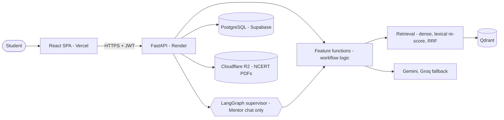
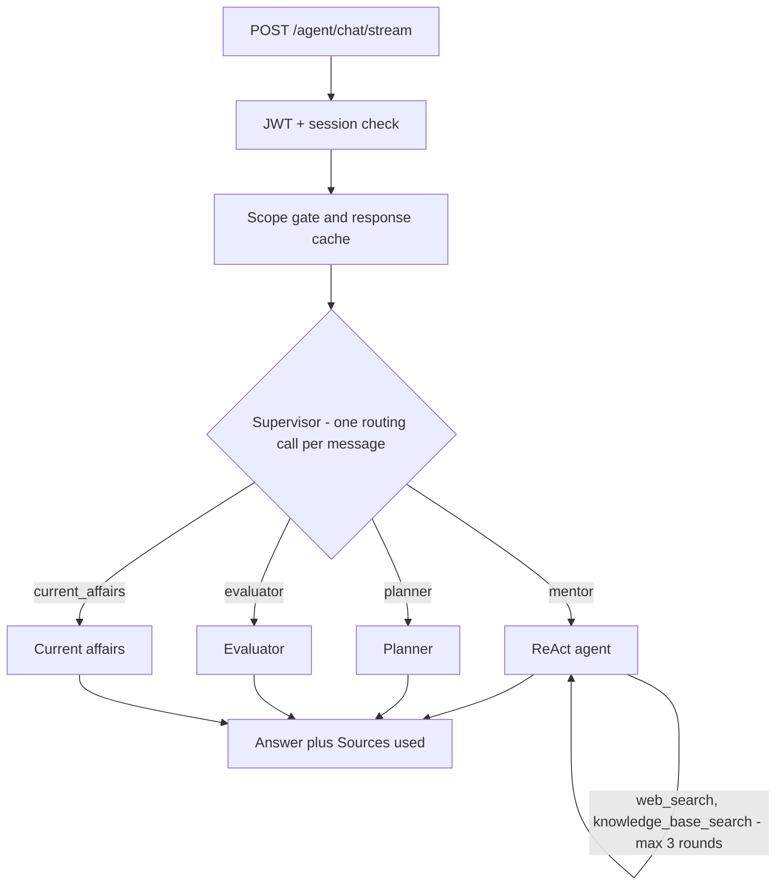
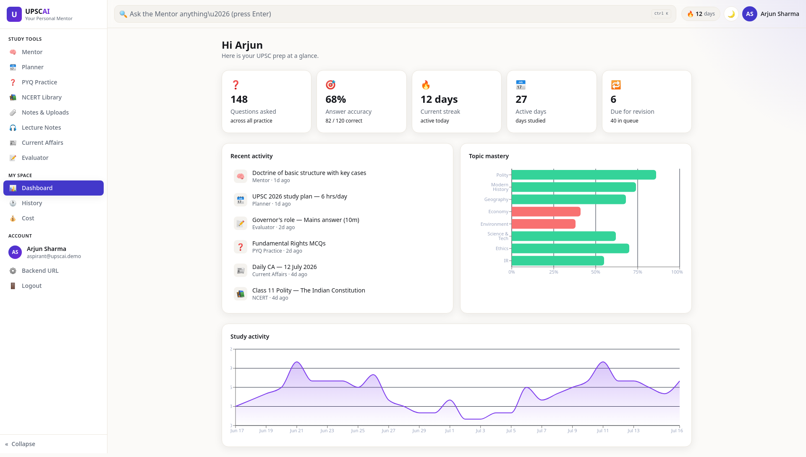
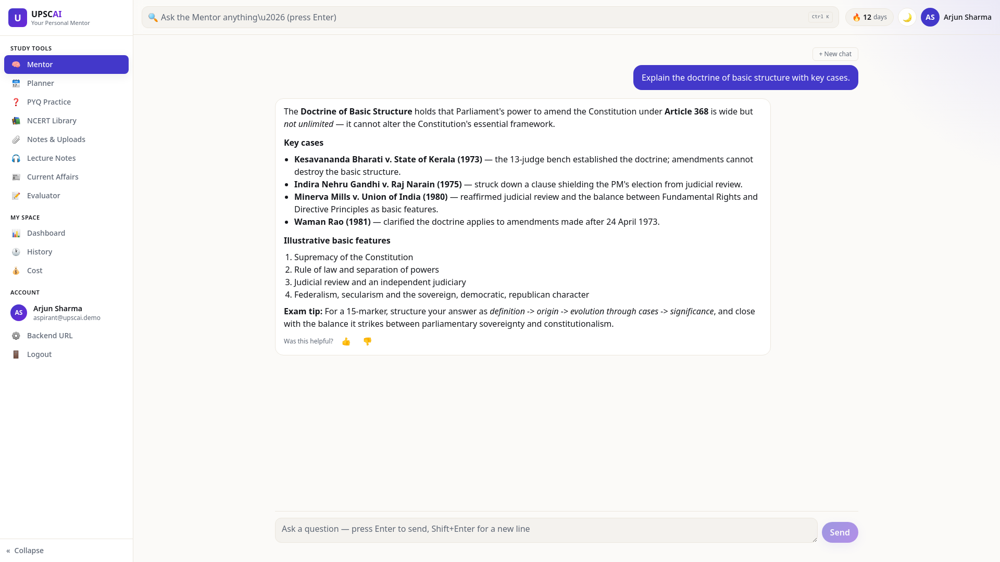
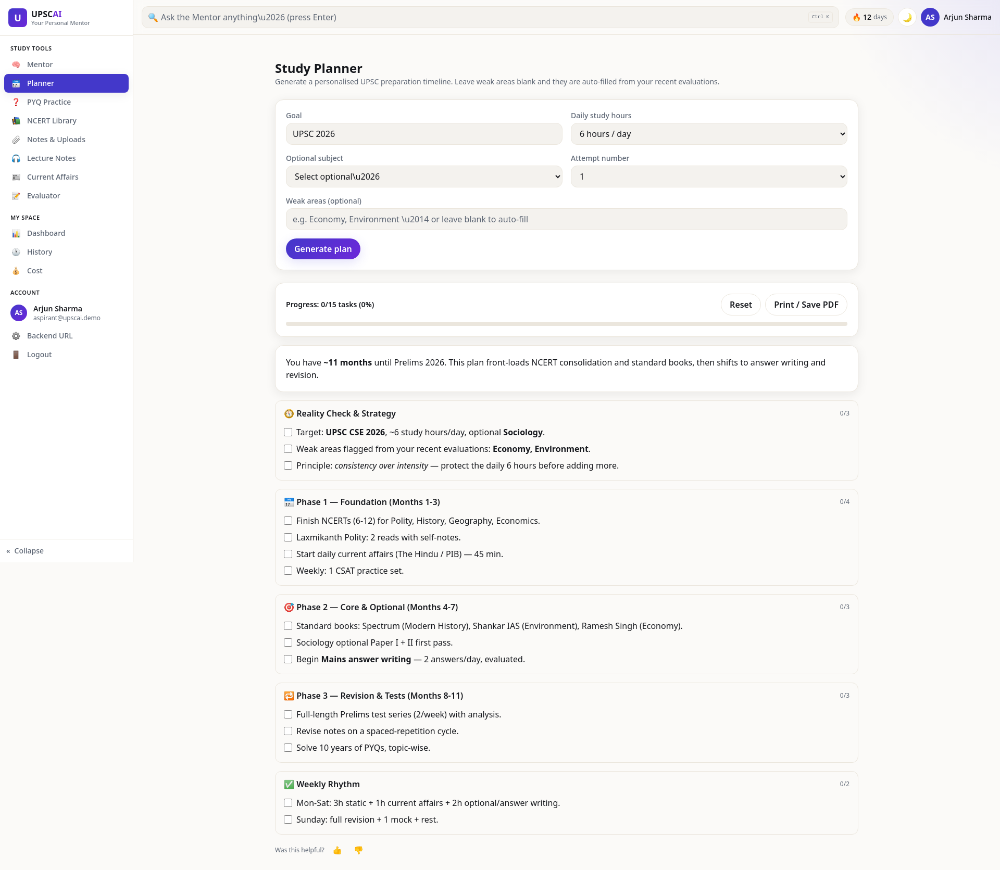
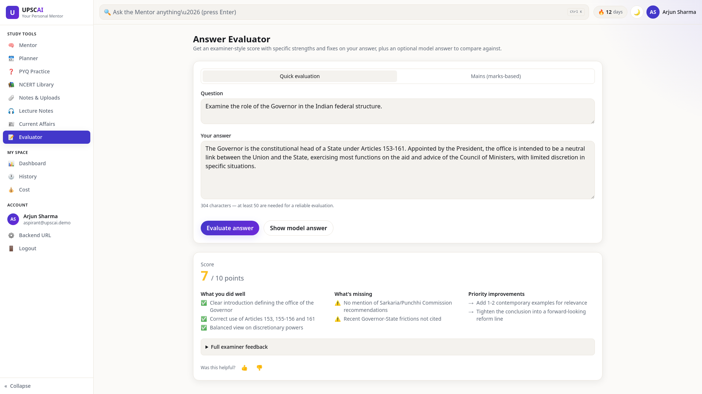
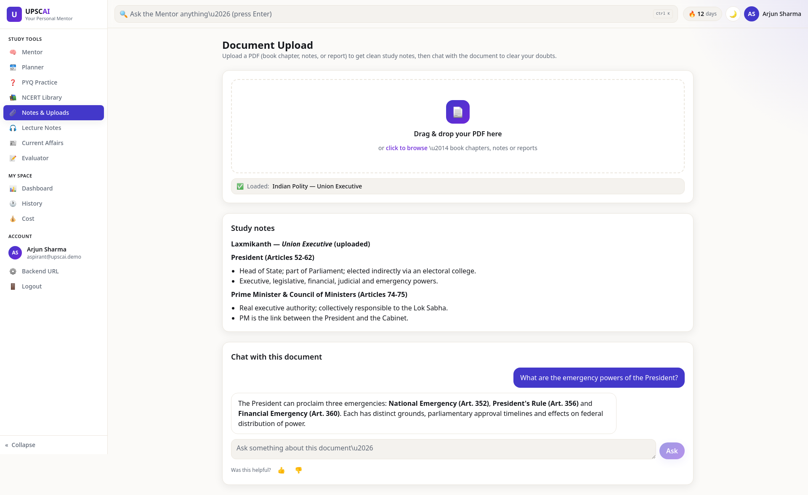
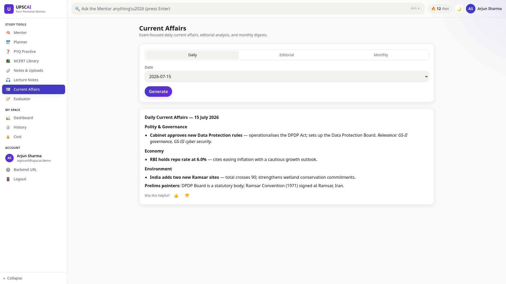

# UPSC AI Pro

**AI-Powered UPSC Learning Platform** with eight study workflows, LangGraph-based AI Mentor routing, retrieval-augmented generation, backend security, automated testing and cloud deployment.

A full-stack GenAI project (FastAPI + LangGraph backend, React/TypeScript frontend) built as an end-to-end engineering exercise on a real domain: preparation for the UPSC Civil Services Examination.

| | |
|---|---|
| Live application | https://upsc-ai-pro.vercel.app/ |
| Backend API | https://upsc-ai-pro-puih.onrender.com |
| API documentation (Swagger) | https://upsc-ai-pro-puih.onrender.com/docs |
| Health check | https://upsc-ai-pro-puih.onrender.com/health |
| Source | https://github.com/Vishal-AI-ML-Dev/UPSC-AI-PRO |

> The backend runs on a free hosting plan that sleeps when idle; the first request after a pause can be slow. Link status is as supplied by the owner and was not re-probed when this README was written.

**Recruiters / non-technical readers:** start with the [2–3 minute project brief](docs/HR_PROJECT_BRIEF.md). **Engineers:** continue below, then the [documentation index](docs/DOCUMENTATION_INDEX.md).

---

## What it does
UPSC preparation is long, the syllabus is huge, and feedback on answer writing is scarce. A general chatbot can sound sure and be wrong, and cannot show a source. UPSC AI Pro brings the main preparation activities together and grounds answers in documents or a curated knowledge base where it can ([product overview](docs/PRODUCT_OVERVIEW.md)).

### Key capabilities
- **Mentor chat** that routes each message to the right specialist and uses web and knowledge-base tools (max three tool rounds).
- **Retrieval-augmented generation** over NCERT chapters, the user's own PDFs, lecture transcripts and a personal PYQ bank.
- **Per-user data isolation** from the database to the vector store and the LangGraph checkpoint.
- **Prompt-injection defence**: untrusted text is fenced; a deterministic UPSC-only scope gate.
- **Reliability layer**: Gemini → Groq fallback, timeouts, circuit breaker, rate limits, recoverable background jobs.
- **1,847 collected offline test cases** (mocked services) and CI on every push.

## The eight study workflows
| # | Workflow | Frontend | Backend route | Orchestration |
|---|---|---|---|---|
| 1 | AI Mentor | `features/mentor` | `POST /agent/chat/stream` | **LangGraph supervisor** + ReAct agent |
| 2 | NCERT Study | `features/ncert` | `/ncert/*` | Plain functions + RAG |
| 3 | PYQ + Personal PYQ Bank | `features/pyq` | `/pyq/*` | Plain functions + RAG + job |
| 4 | Answer Evaluator | `features/evaluator` | `/evaluator/*/sync` | Plain functions |
| 5 | Current Affairs | `features/current_affairs` | `/current-affairs/*` | Plain functions + public feeds |
| 6 | Study Planner | `features/planner` | `/planner/*` | Plain functions + saved plan |
| 7 | Lecture Learning | `features/lecture` | `/lecture/*` | Plain functions + RAG + job |
| 8 | PDF / Document Chat | `features/upload` | `/upload/*` | Plain functions + RAG + job |

> **These are eight workflows, not eight LangGraph agents.** Only the Mentor chat endpoint uses the LangGraph supervisor; the other seven call their own feature functions directly. Details: [WORKFLOWS.md](docs/WORKFLOWS.md).

## Technology stack
| Area | Used in this project |
|---|---|
| Backend | Python 3.13, FastAPI, Pydantic v2, SQLAlchemy, Alembic, uvicorn |
| AI / agents | LangGraph (supervisor, ReAct agent), LangChain, Google Gemini (primary, embeddings), Groq (fallback) |
| Retrieval | Qdrant, `gemini-embedding-001` (768-d), Reciprocal Rank Fusion with lexical re-scoring |
| Data | PostgreSQL (Supabase; SQLite locally and in tests), Cloudflare R2 (NCERT PDFs) |
| Security | JWT + rotating hashed refresh tokens, bcrypt, rate limiting, prompt fencing |
| Frontend | React 18, TypeScript, Vite, TanStack Query, Tailwind CSS |
| DevOps | Docker, GitHub Actions, Render (backend), Vercel (frontend) |
| Optional / not confirmed active | Upstash Redis (cache, shared rate limits), Langfuse (tracing), Sentry (error capture; no DSN configured), Tavily/DuckDuckGo (web search) |
| Implemented but disabled | Cross-encoder reranking, HyDE, multi-query, plan-and-execute, reflection, human-in-the-loop |

## System architecture

More: [ARCHITECTURE.md](docs/ARCHITECTURE.md).

## AI Mentor and RAG flow

The mentor's knowledge-base tool can search only the curated mentor KB; the model cannot choose a user's collection. See [AGENT_ARCHITECTURE.md](docs/AGENT_ARCHITECTURE.md).

## Retrieval and evaluation highlights
- Dense retrieval → lexical re-scoring of the **same candidates** → Reciprocal Rank Fusion (k = 60) → similarity threshold (0.3; mentor KB 0.25). There is **no BM25 index**; cross-encoder reranking, HyDE and multi-query are **off**. ([RAG_AND_RETRIEVAL.md](docs/RAG_AND_RETRIEVAL.md))
- Citations differ by workflow: mentor "Sources used" blocks and NCERT `[S#]` tags are separate mechanisms; NCERT validation checks tag **format**, not whether the source supports the claim. Other workflows have no structured citations.
- Offline retrieval benchmark: 97 queries on four small, mostly synthetic corpora with AI-written labels. It shows the pipeline works on that data; it is **not** proof of production retrieval quality, and it exposed that the thresholds do not reject unanswerable queries (13/13 still retrieved context).
- Offline safety evals found and fixed 21 prompt-construction defects (scripted models; no live-model safety test yet). ([EVALUATION.md](docs/EVALUATION.md))

## Security and reliability highlights
JWT with per-request session check · hashed, rotating refresh tokens · object-level authorization at database, vector, checkpoint and cache boundaries · byte-counted upload limits · security headers and explicit CORS · fixed error messages · Gemini→Groq fallback · circuit breaker · heartbeat-leased background jobs. Known remaining risks (for example tokens in `localStorage`, account enumeration, no production backup yet) are listed in [SECURITY.md](docs/SECURITY.md).

## Verified engineering metrics
Re-measured on 2026-11-05 on a working tree with uncommitted changes. Full method, limits and "safe to quote" notes: [ENGINEERING_METRICS.md](docs/ENGINEERING_METRICS.md).

| Metric | Value | Qualification |
|---|---|---|
| Registered REST operations | 54 under `/api/v1` | From the generated OpenAPI schema |
| Backend Python | 113 modules, 20,185 physical lines (excl. `src/eval`) | Physical lines, not SLOC |
| Frontend TS/TSX | 44 files, 7,663 physical lines | Physical lines |
| Collected test cases | 1,847 | Offline, mocked; collected on the author's working tree (includes unpublished Phase 09 tests, so the published branch has slightly fewer), not re-run for this doc. Last recorded full runs: 1765 passed / 2 skipped (Phase 08 close) |
| Alembic migrations | 6 | |
| Routing bug fix | 160/200 → 0/200 misrouted | Scripted stub models |
| Request-path benchmark | ≈ 13× in one scenario | Synthetic, local, single worker |

No production latency, traffic, cost or hallucination-reduction figures exist, and none are claimed.

## Screenshots
> **UI PREVIEW ONLY — NOT LIVE AI OUTPUT.** These screenshots show the real frontend build running against a **local stand-in API that returned sample, pre-written responses**. They are not responses from Gemini/Groq, not from the deployed backend, and they say nothing about production answer quality, accuracy or speed. Details: [capture report](screenshots/README_SCREENSHOTS.md).

<table>
<tr>
<td width="33%"><div align="center"><sub>Dashboard<br/><i>UI preview - sample data</i></sub></div></td>
<td width="33%"><div align="center"><sub>AI Mentor<br/><i>UI preview - sample data</i></sub></div></td>
<td width="33%"><div align="center"><sub>Study Planner<br/><i>UI preview - sample data</i></sub></div></td>
</tr>
<tr>
<td width="33%"><div align="center"><sub>Answer Evaluator<br/><i>UI preview - sample data</i></sub></div></td>
<td width="33%"><div align="center"><sub>PDF / Document Chat<br/><i>UI preview - sample data</i></sub></div></td>
<td width="33%"><div align="center"><sub>Current Affairs<br/><i>UI preview - sample data</i></sub></div></td>
</tr>
</table>

## Local setup
Prerequisites: Python 3.13 and [uv](https://docs.astral.sh/uv/), Node 20+, a Google AI Studio key (Gemini); Groq key optional. Qdrant is **required** for retrieval workflows; for local use an embedded path avoids running a server.

```bash
# Backend (from the repository root)
uv sync --frozen
cp .env.example .env            # then fill in values locally; never commit .env
# minimum for local retrieval: GOOGLE_API_KEY, QDRANT_PATH=<local folder>
uv run uvicorn src.api.main:app --reload       # http://127.0.0.1:8000  (docs at /docs)

# Frontend (second terminal)
cd frontend
npm install
npm run dev                                    # http://localhost:5173, API defaults to http://127.0.0.1:8000/api/v1
```
Migrations run automatically on app start. Optional Docker Compose for a production-like stack is described in [DEPLOYMENT.md](docs/DEPLOYMENT.md).

### Environment variables
Names, defaults and meanings are defined in `src/core/config.py`; placeholders are in `.env.example`. Do not paste real values anywhere in the repo. Overview by group: [DEPLOYMENT.md](docs/DEPLOYMENT.md#environment-variables).

## Running tests
```bash
uv run pytest -q                                   # offline suite: no keys, no network, throwaway SQLite
uv run ruff check src tests
cd frontend && npm run build && npm run lint
```
The suite mocks LLMs, email and web access; it is not production integration testing. See [TESTING.md](docs/TESTING.md).

## Deployment overview
Vercel serves the SPA; Render runs `alembic upgrade head` then uvicorn from `render.yaml`; Supabase (PostgreSQL), Qdrant Cloud and Cloudflare R2 are external services. Secrets live in the platform dashboards, not in the repository. See [DEPLOYMENT.md](docs/DEPLOYMENT.md).

## Documentation
| Document | Purpose |
|---|---|
| [DOCUMENTATION_INDEX.md](docs/DOCUMENTATION_INDEX.md) | Full map of the docs |
| [HR_PROJECT_BRIEF.md](docs/HR_PROJECT_BRIEF.md) | 2–3 minute non-technical summary |
| [PROJECT_HIGHLIGHTS.md](docs/PROJECT_HIGHLIGHTS.md) | Strongest engineering work, implementation vs measured impact |
| [PRODUCT_OVERVIEW.md](docs/PRODUCT_OVERVIEW.md) | Problem, users, capabilities, limits |
| [ARCHITECTURE.md](docs/ARCHITECTURE.md) | Components, persistence, deployment, trade-offs |
| [WORKFLOWS.md](docs/WORKFLOWS.md) | The eight workflows, one by one |
| [AGENT_ARCHITECTURE.md](docs/AGENT_ARCHITECTURE.md) | Supervisor routing and the ReAct mentor |
| [RAG_AND_RETRIEVAL.md](docs/RAG_AND_RETRIEVAL.md) | Retrieval pipeline, citations, disabled features |
| [API_OVERVIEW.md](docs/API_OVERVIEW.md) | Endpoints, auth, errors, rate limits |
| [SECURITY.md](docs/SECURITY.md) | Controls and remaining risks |
| [TESTING.md](docs/TESTING.md) | Test setup, CI, what is not tested |
| [DEPLOYMENT.md](docs/DEPLOYMENT.md) | Vercel, Render, Supabase, Qdrant, R2 |
| [EVALUATION.md](docs/EVALUATION.md) | Ten-layer evaluation status |
| [ENGINEERING_METRICS.md](docs/ENGINEERING_METRICS.md) | Every number, its method and its limits |
| [DECISIONS.md](docs/DECISIONS.md) · [PROJECT_STATE.md](docs/PROJECT_STATE.md) | ADRs and current engineering state |

## Known limitations and future work
- Answer quality, retrieval quality on real queries, production latency and cost are **unmeasured**; a live-model evaluation tier (T3) has not been run.
- Retrieval thresholds do not reject unanswerable queries on the benchmark data; calibration needs a larger independent dataset.
- Citations are formatted from retrieved sources, not verified claim by claim; only Mentor and NCERT have them.
- Mentor replies arrive whole rather than token by token; background jobs are not resumable; Qdrant has no working fallback.
- Tokens are kept in browser storage; there is no production backup taken yet; Sentry is implemented but not activated; there are no frontend tests.
- Planned / deferred (not in this release): backup/restore procedure and drill, error monitoring activation, additional log-privacy hardening, online evaluation, human-labelled retrieval set, NCERT gold set.

---
**Author:** Vishal Shivhare — GenAI / Backend Engineer · [LinkedIn](https://www.linkedin.com/in/vishal-shivhare-562508243/) · License: MIT, see [LICENSE](LICENSE).
