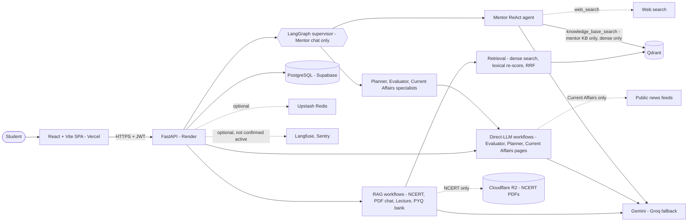
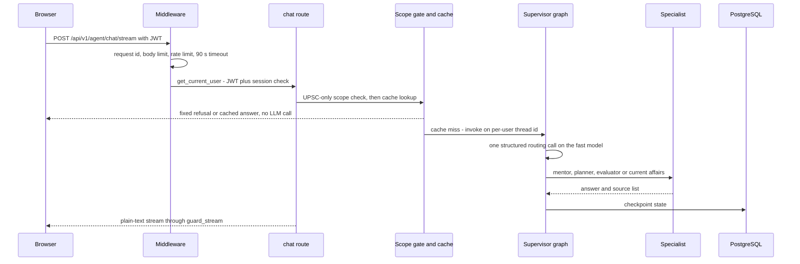
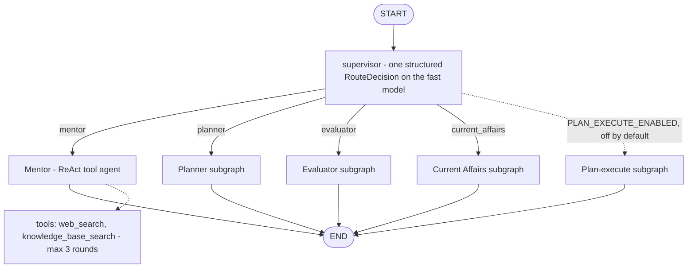
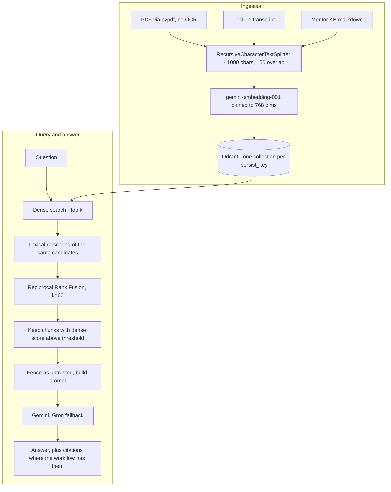

# UPSC AI Pro

**A retrieval-grounded AI study platform for the UPSC Civil Services Exam — eight study workflows, a LangGraph-routed AI Mentor, RAG over owner-scoped documents, and a FastAPI + React stack deployed on free-tier cloud services.**

| | |
|---|---|
| Live application | https://upsc-ai-pro.vercel.app/ |
| Backend API | https://upsc-ai-pro-puih.onrender.com |
| Interactive API docs | https://upsc-ai-pro-puih.onrender.com/docs |
| Health check | https://upsc-ai-pro-puih.onrender.com/health |
| Source | https://github.com/Vishal-AI-ML-Dev/UPSC-AI-PRO |

> Links were supplied by the owner and not re-probed while this README was written. The backend runs on a free plan that sleeps when idle, so the first request after a pause is slow.
> Non-technical reader? Start with the [2–3 minute project brief](docs/HR_PROJECT_BRIEF.md). Everything below is detailed further in the [documentation index](docs/DOCUMENTATION_INDEX.md).

---

## 1. Project Overview

UPSC AI Pro puts the main preparation activities of a UPSC aspirant — asking doubts, studying NCERT chapters, chatting with your own PDFs and lecture transcripts, practising PYQ-style questions, getting answers evaluated, tracking current affairs and planning study time — behind one authenticated web app.

The interesting engineering is in how the AI parts are constrained, not in the number of features:

- **Retrieval-grounded answers** where a workflow has sources, with a documented, measured (and partly disappointing) retrieval pipeline.
- **Per-user isolation for user-owned data**: database rows, uploaded-PDF, pasted-lecture and PYQ-bank vector collections, LangGraph checkpoints and the response cache are scoped to the authenticated user. NCERT, YouTube lecture transcripts and the mentor knowledge base are deliberately **shared, curated global collections**, not owner-scoped.
- **Untrusted-input handling**: uploads, transcripts, web text and student answers are fenced before they reach a prompt.
- **Operational realism**: provider fallback, timeouts, a circuit breaker, recoverable background jobs, versioned migrations — built for free-tier limits.

It is a single repository with a FastAPI + LangGraph backend (`src/`) and a React + Vite + TypeScript SPA (`frontend/`).

**What this is not:** it has no recorded users, customers or revenue, and answer quality has not been measured on real students or with real-model evaluation. Treat it as an engineering case study, not a validated product.

## 2. Problem Statement

UPSC preparation spans a very large syllabus (NCERTs, standard books, current affairs, PYQs) and depends on answer-writing practice with timely feedback. Aspirants typically juggle PDFs, notes, videos and a separate planner.

A general chatbot is a poor fit for a precision exam:

| Failure | Consequence for UPSC prep |
|---|---|
| Confident wrong facts (article numbers, dates, committees) | Wrong facts memorised |
| No source attribution | Nothing to verify against |
| No knowledge of the student's own notes | Cannot answer from *their* PDFs |
| One prompt for everything | Grading an answer, planning a timetable and explaining a concept need different prompts and output contracts |

The design response: ground answers in retrieved text where possible, give each task its own prompt and output contract, route chat messages to the right specialist, and let the model call tools only when needed. How well this works in practice is **not yet measured** with real models; see [Evaluation](#9-evaluation-and-engineering-metrics).

## 3. System Architecture

### High-level architecture



Only the four RAG workflows (NCERT, PDF chat, Lecture, PYQ bank) use the full retrieval pipeline; the Mentor reaches Qdrant only through its KB tool, and Evaluator, Planner and Current Affairs call the LLM directly with no retrieval. Solid edges are required for core functionality (Qdrant and an LLM provider are mandatory for retrieval workflows). Dashed edges are optional or workflow-specific, and the optional ones fail open. Details: [docs/ARCHITECTURE.md](docs/ARCHITECTURE.md).

### Request lifecycle (AI Mentor)



Middleware order, outermost first: `RequestId → HttpMetrics → MaxUploadSize → RateLimit → Timeout(90 s) → SecurityHeaders → CORS` (`src/api/main.py`). The request id is outermost so every log line and the response share one correlation id.

### Responsibilities

| Layer | Responsibility | Where |
|---|---|---|
| Frontend | Routing, per-feature pages, one API client (auth header, one refresh on 401, text streams, job polling), sanitized Markdown rendering | `frontend/src/lib/api.ts`, `frontend/src/features/*` |
| API | Auth, validation, ownership checks, rate limits, streaming with a session guard; thin route handlers | `src/api/routes/*.py` |
| Feature logic | Plain Python functions per workflow, with their own prompts | `src/agents/<feature>/graph.py`, `prompts.py` |
| Orchestration | Supervisor, mentor ReAct agent, memory | `src/graph/` |
| Shared services | LLM factory, vector store, retrieval, grounding, jobs, prompt safety, rate limiting, cache | `src/core/` |
| AI providers | Gemini (chat + embeddings), Groq (chat fallback) | `src/core/llm.py` |
| Data | PostgreSQL (app data, checkpoints), Qdrant (vectors), R2 (NCERT PDFs) | `src/core/db.py`, `vector_store.py`, `ncert_storage.py` |

## 4. AI Workflow Architecture

There are **eight user-facing workflows**. They are **not eight independent LangGraph agents**, and they do not share one `AgentState`. Only the **AI Mentor** chat endpoint uses the LangGraph supervisor; the other seven routes call their own feature functions directly.

| # | Workflow | Frontend | Route | How it runs |
|---|---|---|---|---|
| 1 | AI Mentor | `features/mentor` | `POST /agent/chat/stream` | **LangGraph supervisor** → specialist; mentor is a ReAct tool agent |
| 2 | NCERT Study | `features/ncert` | `/ncert/*` | Plain functions + RAG over an allow-listed chapter |
| 3 | PYQ + Personal PYQ Bank | `features/pyq` | `/pyq/*` | Plain functions; bank upload is a background job |
| 4 | Answer Evaluator | `features/evaluator` | `/evaluator/*/sync` | Plain functions; no retrieval; attempts recorded for the dashboard |
| 5 | Current Affairs | `features/current_affairs` | `/current-affairs/*` | Plain functions over public news feeds |
| 6 | Study Planner | `features/planner` | `/planner/*` | Plain functions; latest plan persisted per user |
| 7 | Lecture Learning | `features/lecture` | `/lecture/*` | Plain functions + RAG; processing is a background job |
| 8 | PDF / Document Chat | `features/upload` | `/upload/*` | Plain functions + RAG; processing is a background job |

Per-workflow routes, storage, citations and limits: [docs/WORKFLOWS.md](docs/WORKFLOWS.md).

### Mentor supervisor routing



- **Routing:** `src/graph/supervisor.py` makes one structured-output call (`RouteDecision`, a `Literal` over four routes) **per message** on the fast model. It defaults to `mentor` if routing fails for a non-timeout reason. Exactly one specialist answers; there is no parallel or multi-step orchestration.
- **Four specialist paths:** `mentor`, `planner`, `evaluator`, `current_affairs`. The last three wrap the same functions as their dedicated pages and parse their inputs from the message text.
- **The only autonomous, tool-using component** is the mentor ReAct agent (`src/graph/tools.py:build_tool_agent`) with two tools: `web_search` and `knowledge_base_search`. The loop is capped at three tool rounds (`DEFAULT_MAX_TOOL_LOOPS = 3`).
- **The model cannot choose a collection.** `knowledge_base_search` searches only the curated mentor KB; the tool schema exposes just `query`.
- **State:** the supervisor is compiled with a PostgreSQL checkpointer and store (SQLite checkpointer plus in-memory store when `DATABASE_URL` is not PostgreSQL). Thread ids are hashed with the authenticated user id.
- **Disabled by default:** plan-and-execute, reflection and human-in-the-loop. The CRAG graph (`src/graph/rag_graph.py`) is not reachable over HTTP.

Full detail: [docs/AGENT_ARCHITECTURE.md](docs/AGENT_ARCHITECTURE.md).

## 5. RAG and Retrieval Architecture



| Item | Implementation |
|---|---|
| Embeddings | `models/gemini-embedding-001`, **768 dimensions**. A wrapper (`_DimPinnedEmbeddings`) requests the dimension *and* truncates + L2-normalises every vector, because the SDK constructor argument silently did not apply |
| Vector store | Qdrant (server via `QDRANT_URL`, or embedded `QDRANT_PATH`); **required** — a Chroma fallback is coded but its package is not installed |
| Chunking | `RecursiveCharacterTextSplitter`, 1,000 characters, 150 overlap |
| Retrieval | Dense similarity → **lexical re-scoring of the same dense candidates** (concept coverage with UPSC abbreviation expansion) → **Reciprocal Rank Fusion**, k = 60 |
| Thresholds | `SIMILARITY_THRESHOLD` 0.3 (shared pipeline), `MENTOR_KB_THRESHOLD` 0.25 (mentor KB, dense only), applied to the dense score |
| Response cache | Exact + semantic (cosine ≥ 0.92), 24 h TTL, scoped per user and thread; mentor chat only; needs Upstash credentials (production use unverified) |

**Not a BM25 index.** The lexical stage only re-orders dense hits; it cannot surface a chunk the dense search missed.

**Implemented but disabled by default:** cross-encoder reranking (`RERANK_ENABLED=false`; the local provider needs `sentence-transformers`, which is not a dependency), HyDE (`HYDE_ENABLED=false`) and multi-query expansion (`MULTI_QUERY_ENABLED=false`). They are not active features.

**Collections and ownership.** One Qdrant collection per server-built `persist_key`. User-owned collections embed the owner id from the JWT (`upload_<user>_<md5>`, `lecture_<user>_paste_<id>`, `pyqbank_<user>`); NCERT, YouTube lectures and the mentor KB are global. Clients never supply a raw key.

**Citations are not universal and are not verified claim by claim.**

| Workflow | Citation behaviour |
|---|---|
| AI Mentor | "Sources used" block built from tool results (numbered web sources and KB sources) |
| NCERT Study | `[S#]` tags plus a footer; only tag **format** is validated (a tag must match a retrieved excerpt) — not that the excerpt supports the sentence |
| PDF, lecture, PYQ bank | Grounded answers; no structured citation block |
| Others | None |

Deep dive, including the threshold finding below: [docs/RAG_AND_RETRIEVAL.md](docs/RAG_AND_RETRIEVAL.md).

## 6. Core Engineering Decisions

Each decision lists the problem, the choice and the cost. Longer records are in [docs/DECISIONS.md](docs/DECISIONS.md).

**FastAPI**
- *Problem:* typed contracts, streaming responses and generated API docs for an LLM-heavy backend in one language with the AI stack.
- *Decision:* FastAPI + Pydantic v2; thin route handlers over plain feature functions.
- *Tradeoff:* blocking work (sync SQLAlchemy, pypdf, LLM `.invoke`) must stay out of `async def` handlers. This was a real defect: 18 blocking handlers were moved to plain `def` (ADR-011), which in a synthetic local benchmark raised throughput on a blocking-LLM scenario from about 1.4–1.6 to about 19–20 requests/s.

**React + Vite SPA**
- *Problem:* a fast, static frontend that can be hosted free and talks to a separate API.
- *Decision:* React 18 + TypeScript + Vite, lazy-loaded feature routes, TanStack Query, one API client module. Deployed as static files on Vercel (not Next.js; no server rendering).
- *Tradeoff:* the API base URL is compiled in (`VITE_API_BASE`); access/refresh tokens live in `localStorage`, which enlarges the impact of any XSS bug (known risk). No frontend tests exist.

**PostgreSQL (Supabase)**
- *Problem:* users, sessions, history, jobs, plans, evaluation attempts and LangGraph checkpoints need durable, relational storage.
- *Decision:* SQLAlchemy + Alembic (six revisions) on Supabase PostgreSQL via the pooler; SQLite for local runs and tests. LangGraph's Postgres saver/store reuse the same database.
- *Tradeoff:* LangGraph tables are created at runtime outside Alembic; with a non-Postgres URL the long-term store is in memory and lost on restart; automated tests never touch PostgreSQL (migrations were rehearsed manually on disposable PostgreSQL 15/17).

**Qdrant**
- *Problem:* vectors must not live on the free app disk, and collections need per-owner isolation.
- *Decision:* managed Qdrant, one collection per server-built key.
- *Tradeoff:* a hard dependency with no working fallback; many small collections; a partially indexed upload is not repaired on retry.

**Gemini primary, Groq fallback**
- *Problem:* a free-tier quota error should not take chat down.
- *Decision:* `gemini-2.5-flash` (main) and `gemini-2.5-flash-lite` (router/fast), with Groq `llama-3.3-70b-versatile` / `llama-3.1-8b-instant` via LangChain `with_fallbacks`; 45 s per-call timeout, one retry, 4,096-token output cap. A timeout ends the request rather than cascading.
- *Tradeoff:* two providers with different behaviour; real fallback frequency, latency and cost per workflow are **not measured**.

**Background jobs without a broker**
- *Problem:* PDF/lecture processing outlasts a safe request budget on one worker.
- *Decision:* an in-process thread pool (`src/core/job_queue.py`); status and result live in a `jobs` table; heartbeat lease so a sibling worker only fails genuinely stale jobs; conditional status transitions so a late result cannot overwrite a failure; transient-only retries; 900 s deadline. **No Redis, RQ or Celery.**
- *Tradeoff:* work is **not resumable** — inputs are in memory, so a job whose process dies ends in `error` and the user retries. Behaviour on PostgreSQL with several workers is unverified.

## 7. Security and Reliability

| Area | Control | Source |
|---|---|---|
| Authentication | JWT (HS256, 30 min) plus a **per-request database check** of the session id (single active session); fail closed (503) if the lookup fails | `src/api/deps.py` |
| Refresh tokens | Opaque, stored as SHA-256 hashes, **rotated** on every refresh, revoked on logout | `src/core/refresh_tokens.py` |
| Object-level authorization | Every owned query filters by user id; vector keys built server-side; model tool limited to the mentor KB; thread ids and cache keys hashed with the user id | `src/core/history.py`, `src/agents/*`, `src/api/routes/chat.py` |
| Prompt injection | `harden_untrusted()` fences uploads, transcripts, web/KB text, feed text, student answers and profile fields, neutralising spoofed markers; deterministic UPSC-only scope gate | `src/core/prompt_safety.py`, `src/core/scope_gate.py` |
| Input limits | `Field(max_length=…)` on free text; 1 MiB JSON body limit; uploads capped at 50 MB, counted on actual bytes, `%PDF-` signature checked | `src/schemas.py`, `src/api/upload_limit.py` |
| Rate limiting | 100 req / 60 s per IP globally; 10 / 300 s on credential and email endpoints; `429` with `Retry-After` | `src/api/rate_limit.py` |
| HTTP hardening | Explicit CORS allow-list, security headers (HSTS, nosniff, frame deny, CSP), fixed error messages, request ids | `src/api/security_headers.py`, `src/api/main.py` |
| Streams | `guard_stream` re-checks the session during long responses | `src/api/stream_guard.py` |
| Reliability | Provider fallback, per-call timeout, circuit breaker around Upstash, fail-open optional dependencies, job lease/deadline | `src/core/llm.py`, `circuit_breaker.py`, `job_queue.py` |

**Known remaining risks** (full list in [docs/SECURITY.md](docs/SECURITY.md)): tokens in `localStorage`; account enumeration on register/login timing; no per-user active-job cap and upload bytes held in memory; real-model prompt-injection and scope behaviour never tested live; a 24 h semantic cache can serve stale time-sensitive answers; public `/docs` in production; no external penetration test.

## 8. Implemented Features

| Feature | Code reference |
|---|---|
| LangGraph supervisor, four specialists, mentor ReAct agent (max 3 tool rounds) | `src/graph/supervisor.py`, `tools.py`, `agent_subgraphs.py` |
| UPSC-only scope gate (no LLM call) | `src/core/scope_gate.py` |
| Dense retrieval + lexical re-scoring + RRF; thresholds | `src/core/retrieval.py`, `vector_store.py` |
| Mentor and NCERT citations (different mechanisms) | `src/core/grounding.py`, `src/agents/ncert/graph.py` |
| NCERT study sessions from allow-listed R2 PDFs | `src/agents/ncert/graph.py`, `src/core/ncert_storage.py` |
| PDF chat, lecture notes/chat, personal PYQ bank (owner-scoped) | `src/agents/upload`, `lecture`, `pyq` |
| Answer evaluator (basic, Mains, model answer) with bounded scores; attempts recorded | `src/agents/evaluator/graph.py`, `src/core/evaluation_history.py` |
| Study planner with saved plan and progress | `src/agents/planner/graph.py`, `src/core/study_plans.py` |
| Dashboard analytics (average score, subject mastery, weak subjects) | `src/api/routes/progress.py` |
| Current-affairs digests from public feeds | `src/agents/current_affairs/graph.py` |
| Background jobs with lease and recovery | `src/core/job_queue.py` |
| Auth: register, login, rotate refresh, verify/reset email, single session | `src/api/routes/auth.py`, `src/core/users.py` |
| Session history and feedback | `src/api/routes/history.py`, `feedback.py` |
| Admin overviews (cost, monitoring, experiments) | `src/api/routes/cost.py`, `monitoring.py`, `experiments.py` |
| Workflow evaluation harness (offline T1/T2) | `evals/` |
| Alembic migrations 0001–0006 | `migrations/versions/` |

**Present in code but disabled or not confirmed active:** cross-encoder reranking, HyDE, multi-query, plan-and-execute, reflection, human-in-the-loop (all off by default); Upstash Redis, Langfuse and Sentry (optional; no Upstash or Sentry configuration in `render.yaml`, and no Sentry DSN is set).

### Screenshots

> **UI PREVIEW ONLY — NOT LIVE AI OUTPUT.**
> These screenshots show the real frontend build running against a **local stand-in API that returned sample, pre-written responses**. They are not responses from Gemini or Groq, not from the deployed backend, and they say nothing about production answer quality, accuracy or speed. Details: [screenshot notes](screenshots/README_SCREENSHOTS.md).

<table>
<tr>
<td width="33%"><div align="center"><sub>Dashboard<br/><i>UI preview - sample data</i></sub></div></td>
<td width="33%"><div align="center"><sub>AI Mentor<br/><i>UI preview - sample data</i></sub></div></td>
<td width="33%"><div align="center"><sub>Study Planner<br/><i>UI preview - sample data</i></sub></div></td>
</tr>
<tr>
<td width="33%"><div align="center"><sub>Answer Evaluator<br/><i>UI preview - sample data</i></sub></div></td>
<td width="33%"><div align="center"><sub>PDF / Document Chat<br/><i>UI preview - sample data</i></sub></div></td>
<td width="33%"><div align="center"><sub>Current Affairs<br/><i>UI preview - sample data</i></sub></div></td>
</tr>
</table>

## 9. Evaluation and Engineering Metrics

Repository facts were counted on 2026-11-05 on the author's working tree, which held uncommitted, unpublished changes; the published branch can differ slightly. Method, limits and "safe to quote" notes per number: [docs/ENGINEERING_METRICS.md](docs/ENGINEERING_METRICS.md).

| Metric | Value | Qualification |
|---|---|---|
| Registered REST operations | 54 under `/api/v1` | From the generated OpenAPI schema |
| Backend Python | 113 modules, 20,185 physical lines (excl. `src/eval`) | Physical lines, not SLOC |
| Frontend TS/TSX | 44 files, 7,663 physical lines | Physical lines |
| Collected test cases | 1,847 | **Collected, not passed.** Offline, mocked services; the count includes an unpublished test file and was not measured for the published branch |
| Last recorded full-suite run | `1765 passed, 2 skipped` | Phase 08 close, 2026-11-04; recorded, **not re-run** for this README |
| Alembic migrations | 6 | |

**Offline and synthetic results (none is production performance):**

| Result | What it actually shows | Limits |
|---|---|---|
| Mentor routing: 160/200 → 0/200 misrouted | A bug where the first message's route was reused for the whole conversation was fixed | Scripted/stubbed router and specialists; says nothing about real-model routing accuracy |
| Request path: roughly 13× throughput in one scenario | Moving blocking handlers off the event loop helps under a blocking call | Synthetic, local, single worker, fake LLM and auth |
| Prompt-injection evals: 21 → 0 failures | Prompt-construction defects (unfenced values, spoofable markers) were found and fixed | Deterministic offline checks of built prompts (tier T1); 60 cases, 1 known gap; no live-model safety test (T3 never run) |
| Retrieval benchmark: 97 queries, pooled Recall@k 0.988, MRR@k 0.935 | The pipeline works on a small benchmark | Four small corpora (three synthetic), AI-written and not human-verified labels, a ceiling effect; NCERT unmeasured. **Not a production quality claim** |
| Threshold finding: 13/13 unanswerable queries still retrieved context | The 0.3 / 0.25 thresholds filter nothing on this data | Retrieval-only, n = 13; documented, not fixed |
| Job-reliability benchmark | 0 false reaps; dead jobs recovered in about one lease length | Offline, multi-process, SQLite, scaled-down timings |

**Not measured, so not claimed:** production latency (P50/P95/P99), real-LLM cost per workflow, real-model answer quality, hallucination reduction, user counts or traffic.

**CI judge gate.** CI defines a nightly/manual LLM-as-judge job, but it targets the CRAG graph that no HTTP route serves, needs secrets, and is not a per-commit gate. The committed sample report `src/eval/eval_report.md` (3 cases) has **UNVERIFIED** provenance and is not evidence of production faithfulness. See [docs/EVALUATION.md](docs/EVALUATION.md) for all ten evaluation layers and [docs/TESTING.md](docs/TESTING.md) for CI.

## 10. Lessons Learned and Technical Limitations

**Lessons (each found in this codebase):**
- *Verify the shape of what a config knob produces.* The Gemini embedding SDK silently ignored the dimension argument, so vectors stayed 3,072-d against a 768-d collection. The wrapper now pins the dimension, truncates and normalises so the output shape is guaranteed.
- *Persisted state can silently override logic.* The supervisor once reused the first message's saved route for every later message; routing is now recomputed per message (ADR-014) and a benchmark covers it.
- *Sanitizers need adversarial review.* A review reproduced nested and look-alike fence markers that survived the first version; each became a regression test.
- *Measure before tuning.* The retrieval benchmark showed that RRF and over-fetching gave no robust gain and that thresholds filtered nothing, so no production retrieval change was made (ADR-015).
- *Ownership belongs at every boundary.* An early audit found model-chosen collection keys; keys are now built server-side and the model-facing tool is KB-only (ADR-007).
- *Blocking calls on one worker are an outage waiting to happen* (ADR-011).

**Limitations and technical debt:**
- Answer quality, routing accuracy and safety against **real models** are unmeasured; no live (T3) evaluation has been run.
- Retrieval thresholds do not reject unanswerable queries; calibration needs a larger independent dataset.
- Citations are formatted from retrieved sources, not verified; only Mentor and NCERT have them.
- Mentor answers arrive as one completed message, not token by token (nested subgraphs with `subgraphs=False`).
- Jobs are not resumable; no per-user job cap; Qdrant has no working fallback; scanned PDFs are unsupported (no OCR).
- Tokens in browser storage; account enumeration; no frontend tests; lint and prettier are non-blocking in CI; the live smoke job is disabled.
- No production backup has been taken; Sentry code exists but is not activated; Langfuse and Upstash activation in production are unverified.
- Free-tier hosting: cold starts after idle; NCERT content depends on an external storage bucket.

## 11. Repository Structure

```text
UPSC-AI-PRO/
├── src/
│   ├── api/            FastAPI app, middleware, auth dependencies, routes/ (one module per feature)
│   ├── agents/         Feature logic as plain functions (ncert, pyq, evaluator, current_affairs,
│   │                   planner, lecture, upload, mentor) with prompts.py each
│   ├── graph/          LangGraph: supervisor, mentor ReAct agent, subgraphs, memory, CRAG (eval only)
│   ├── core/           LLM, vector store, retrieval, grounding, jobs, prompt safety, config, models
│   ├── eval/           Legacy LLM/retrieval eval harness and retrieval benchmark data
│   └── schemas.py      Pydantic API contracts
├── frontend/           React + Vite + TypeScript SPA (src/features, src/lib/api.ts)
├── migrations/         Alembic revisions 0001-0006
├── tests/              Offline pytest suite (real app on throwaway SQLite, mocked LLM/email)
├── evals/              Workflow evaluation harness (T1/T2 offline; T3 live disabled)
├── scripts/            Benchmarks (request path, jobs, routing, retrieval) and KB ingestion
├── data/               Mentor knowledge base source; NCERT PDFs are not in the repo
├── docs/               Engineering documentation (index: docs/DOCUMENTATION_INDEX.md)
├── screenshots/        UI previews with sample data
├── Dockerfile, docker-compose.yml, render.yaml   Container, local stack, Render blueprint
└── pyproject.toml, uv.lock                        Locked Python environment
```

## 12. Local Development

Prerequisites: Python 3.13 with [uv](https://docs.astral.sh/uv/), Node 20+, a Google AI Studio key (Gemini); a Groq key is optional. Qdrant is required for retrieval workflows; an embedded local path avoids running a server.

```bash
# Backend, from the repository root
uv sync --frozen
cp .env.example .env              # fill in values locally; never commit .env
# minimum for local retrieval: GOOGLE_API_KEY and QDRANT_PATH=<local folder>
uv run uvicorn src.api.main:app --reload       # http://127.0.0.1:8000, docs at /docs

# Frontend, second terminal
cd frontend
npm install
npm run dev                                    # http://localhost:5173, API defaults to http://127.0.0.1:8000/api/v1
```

Migrations run automatically on application start. Variable names, defaults and meanings are in `src/core/config.py` and `.env.example`; never paste real values anywhere in the repository.

```bash
uv run pytest -q                  # offline suite: no keys, no network, throwaway SQLite
uv run ruff check src tests
cd frontend && npm run build && npm run lint
```

The suite mocks LLMs, email and web access; it is not production integration testing. See [docs/TESTING.md](docs/TESTING.md) and [docs/API_OVERVIEW.md](docs/API_OVERVIEW.md).

## 13. Production Deployment

| Layer | Service | Notes |
|---|---|---|
| Frontend | Vercel | `frontend/vercel.json`: `npm run build` → `dist`, SPA rewrite; API base compiled in from `VITE_API_BASE` |
| Backend | Render (free plan, Singapore) | `render.yaml`: `uv sync --frozen`; start `alembic upgrade head` then uvicorn with `--proxy-headers`; health check `/health` |
| Database | Supabase PostgreSQL | Pooler connection string kept as a secret |
| Vectors | Qdrant Cloud | Required |
| Files | Cloudflare R2 (private bucket) | NCERT PDFs only |
| LLMs | Gemini, Groq | API keys kept as secrets |
| Optional | Upstash Redis, Langfuse, Sentry | Not confirmed active in production |

Secrets live in the platform dashboards, never in the repository. **Rollback rule:** a newer migration is applied at boot and an older image cannot start against a newer revision, so fix forward rather than using a dashboard rollback. Full procedure, verification steps and free-tier behaviour: [docs/DEPLOYMENT.md](docs/DEPLOYMENT.md); the original walkthrough is [DEPLOYMENT_GUIDE.md](DEPLOYMENT_GUIDE.md).

## 14. What This Project Demonstrates

| Skill | Evidence in the repository |
|---|---|
| Backend engineering | FastAPI service with 54 operations, Pydantic contracts, streaming with a session guard, Alembic migrations, a persisted job system |
| LLM application design | Per-message structured routing, a bounded ReAct tool agent, provider fallback, timeouts, history bounding |
| RAG | Embedding pinning, chunking, dense + lexical + RRF retrieval, owner-scoped collections, a measured benchmark with honest limitations |
| Security | Session-checked JWT, rotating hashed refresh tokens, object-level authorization at four boundaries, prompt fencing, upload and rate limits |
| Evaluation discipline | Tiered evals (T1/T2/T3) that state what they do not prove; dated, qualified benchmarks; unverified items labelled as such |
| Testing and CI | An offline suite with mocked dependencies, regression tests per bug, GitHub Actions for tests and build |
| Delivery | Docker, Render and Vercel deployments, owner-reported production migration releases, written specs, plans and decision records |

The role split is described honestly in [docs/HR_PROJECT_BRIEF.md](docs/HR_PROJECT_BRIEF.md): product and engineering direction by the owner, with much of the implementation done with an AI coding assistant under approved specs.

## 15. Recruiter Takeaway

UPSC AI Pro is a full-stack GenAI/backend project that was taken from design through deployment and treated like a system that must survive review: eight workflows on one FastAPI + React codebase, a LangGraph-routed mentor, a retrieval pipeline whose weaknesses were measured rather than hidden, per-user isolation, and an offline test and evaluation setup that is explicit about its limits. It is a strong signal of backend and applied-LLM engineering judgement and of honest measurement. It is **not** evidence of product-market fit, real-world scale, production latency or real-model answer quality; none of those has been measured.

**Where to go next:** [project brief for non-engineers](docs/HR_PROJECT_BRIEF.md) · [highlights](docs/PROJECT_HIGHLIGHTS.md) · [architecture](docs/ARCHITECTURE.md) · [agents](docs/AGENT_ARCHITECTURE.md) · [RAG](docs/RAG_AND_RETRIEVAL.md) · [security](docs/SECURITY.md) · [metrics](docs/ENGINEERING_METRICS.md) · [documentation index](docs/DOCUMENTATION_INDEX.md)

---
**Author:** Vishal Shivhare — GenAI / Backend Engineer · [LinkedIn](https://www.linkedin.com/in/vishal-shivhare-562508243/) · License: MIT, see [LICENSE](LICENSE).
