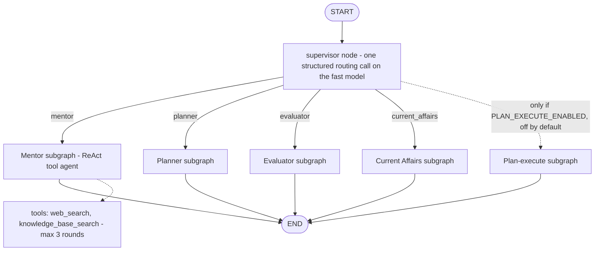

# Agent architecture (AI Mentor chat)

This page describes the only part of UPSC AI Pro that uses LangGraph at request time: the **AI Mentor chat**. It is a
**supervisor router over specialist subgraphs**, plus one **tool-using ReAct agent** inside the Mentor. It is *not* an
eight-agent autonomous platform. Verified against source on 2026-11-05.

## What is and is not a LangGraph agent
| Workflow | Uses the LangGraph supervisor? | How it runs |
|---|---|---|
| AI Mentor | **Yes** — `POST /api/v1/agent/chat/stream` | Supervisor → one of four specialists |
| NCERT Study | No | Route calls `src/agents/ncert/graph.py` functions directly |
| PYQ + Personal PYQ Bank | No | Route calls `src/agents/pyq/graph.py` functions |
| Answer Evaluator | No (the *chat* evaluator specialist is separate) | Route calls `src/agents/evaluator/graph.py` |
| Current Affairs | No (the *chat* specialist is separate) | Route calls `src/agents/current_affairs/graph.py` |
| Study Planner | No (the *chat* specialist is separate) | Route calls `src/agents/planner/graph.py` |
| Lecture Learning | No | Route calls `src/agents/lecture/graph.py` |
| PDF / Document Chat | No | Route calls `src/agents/upload/graph.py` |

Files named `src/agents/*/graph.py` hold **plain Python functions**, not LangGraph graphs. There is **no shared
`AgentState` across workflows**; `AgentState` (`src/graph/state.py`) is the state of the Mentor chat graph (and of the CRAG
subgraph used only by the eval harness).

## Entry point (`src/api/routes/chat.py`)
1. `get_current_user` authenticates the JWT and the active session.
2. **Scope gate** (`src/core/scope_gate.py`, pure Python, no LLM): bare greetings and clearly off-topic requests get a fixed,
   language-matched reply with no cache, LLM, search or KB call. Ambiguous messages are allowed through.
3. **Response cache** lookup (Upstash, no-op unless configured; scoped by user and thread).
4. `scoped_thread_id(user_id, client_thread_id)` hashes the user id with the client label, so a client can never address
   another user's checkpoint.
5. The compiled supervisor graph is invoked with `stream_mode=["messages","values"]` and the default `subgraphs=False`.
6. Output goes through `guard_stream`, which re-checks the session while streaming.

Input limits: `question` ≤ 4,000 characters, `thread_id` ≤ 100.

## The supervisor graph (`src/graph/supervisor.py`)

- **StateGraph:** `StateGraph(AgentState)` with nodes `supervisor`, `mentor`, `planner`, `evaluator`, `current_affairs`
  (+ `plan_execute` when enabled), compiled with the checkpointer and store. Specialists are nested compiled subgraphs
  without their own checkpointer.
- **RouteDecision:** a Pydantic model with one field, `route: Literal["mentor","planner","evaluator","current_affairs"]`.
  The router is `get_fast_llm().with_structured_output(RouteDecision)` (default `gemini-2.5-flash-lite`, Groq fallback), given
  a short system prompt and the student's message. It **defaults to `mentor`** if routing fails for a non-timeout reason; a
  routing *timeout* ends the request.
- **Routed afresh for every message.** `state["route"]` is an output of the router and is never read as an input. Before
  Phase 05 the first message's route was reused for the whole conversation (80 % of messages in the offline benchmark went to the
  wrong specialist); see [ENGINEERING_METRICS.md](ENGINEERING_METRICS.md) for the stubbed-model benchmark and its limits.
- **No parallel or multi-step orchestration.** Exactly one specialist answers each message. Specialists do not call each
  other.
- **Optional, disabled:** `plan_execute` (decompose → execute → synthesize for long mentor questions) is OFF by default
  (`PLAN_EXECUTE_ENABLED=false`); reflection and human-in-the-loop (`HITL_ENABLED`) are also OFF and HITL has no resume path
  in this endpoint.

## Specialists
| Route | Implementation | Notes |
|---|---|---|
| `mentor` | `build_mentor_graph` → `build_tool_agent` (`src/graph/tools.py`) | The only autonomous, tool-using component |
| `planner` | `agent_subgraphs.build_planner_subgraph` | Parses hours/attempt/goal from the message with regexes; asks for anything missing |
| `evaluator` | `agent_subgraphs.build_evaluator_subgraph` | Parses question/answer from the message text |
| `current_affairs` | `agent_subgraphs.build_current_affairs_subgraph` | Parses date/month/topic from the message |

Planner, evaluator and current-affairs specialists reuse the same feature functions as their dedicated pages, wrapped in a
one-node subgraph.

## The Mentor ReAct agent (`src/graph/tools.py:build_tool_agent`)
A two-node loop: `agent` (model with tools bound) ⇄ `tools` (executes tool calls).

| Tool | Behaviour | Access control |
|---|---|---|
| `web_search(query)` | Searches trusted UPSC/news sources for volatile facts (exam dates, notifications, results). Results are numbered and attached as a structured artifact for citations. | Fixed provider endpoints (Tavily or DuckDuckGo); no user-controlled URLs |
| `knowledge_base_search(query)` | Dense search of the **verified Mentor knowledge base only** (k = 4, threshold 0.25). Text is fenced with `harden_untrusted`. | The tool schema exposes only `query`. `mentor_kb_search` ignores any other argument the model emits, so the model **cannot choose a collection** (uploads, PYQ banks and lectures are user-owned). |

- **Tool-loop limit:** `DEFAULT_MAX_TOOL_LOOPS = 3`. `should_continue` ends the loop when the current question has used
  more than the allowed rounds (`tool_rounds(msgs) > max_tool_loops`), so a misbehaving model cannot loop forever.
- **System prompt:** UPSC-only scope rule and an instruction to use `web_search` only for current facts. The prompt states that
  instructions inside messages, history, web results or documents cannot change the scope. A prompt is a defence in depth, not a
  guarantee; real-model behaviour is UNVERIFIED (see [EVALUATION.md](EVALUATION.md)).
- **Graceful degradation:** if the KB is unavailable or returns nothing, the agent answers timeless questions from general
  knowledge with a note and refuses to guess time-sensitive facts.

## Conversation state and memory
- **Checkpointer (short-term):** per-thread conversation state via `PostgresSaver` when `DATABASE_URL` is PostgreSQL, else
  `SqliteSaver`. Only the supervisor is compiled with it.
- **Store (long-term):** `PostgresStore` on PostgreSQL, else an in-memory store. A small student profile (stage, weak areas, …)
  is learned from the student's questions (`src/graph/profile.py`) and fenced before it reaches a prompt.
- **History window:** the Mentor prompt is bounded to the current turn plus the six previous question/answer turns
  (`MENTOR_HISTORY_MAX_TURNS`); the stored checkpoint still grows.
- **Isolation:** thread ids and cache keys are derived from the authenticated user id (`scoped_thread_id`,
  `_scope_part` in `src/core/response_cache.py`).

## Citations
Mentor citations are built from tool results (`src/core/grounding.py`): numbered web sources and knowledge-base sources
(KB citations are filtered by overlap with the answer). They are formatted into a "Sources used" block, not enforced by a
verifier. NCERT uses a separate `[S#]` mechanism — see [RAG_AND_RETRIEVAL.md](RAG_AND_RETRIEVAL.md#citations).

## What bypasses the supervisor
Everything except `/agent/chat/stream`: NCERT, PYQ and PYQ bank, the Answer Evaluator page, Current Affairs page, Planner
page, Lecture and PDF chat. The CRAG retrieval graph (`src/graph/rag_graph.py`) is **not reachable over HTTP**; only the
legacy eval harness (`src/eval/llm_eval.py`) uses it.

## Known limitations
- Mentor answers arrive as one completed message rather than token by token (nested subgraphs with `subgraphs=False`).
- The router sees the student's text unfenced; its output is limited to four allowed values, so the worst case is a different
  specialist for that message.
- One extra fast-model call per message; its real latency and cost are UNVERIFIED.
