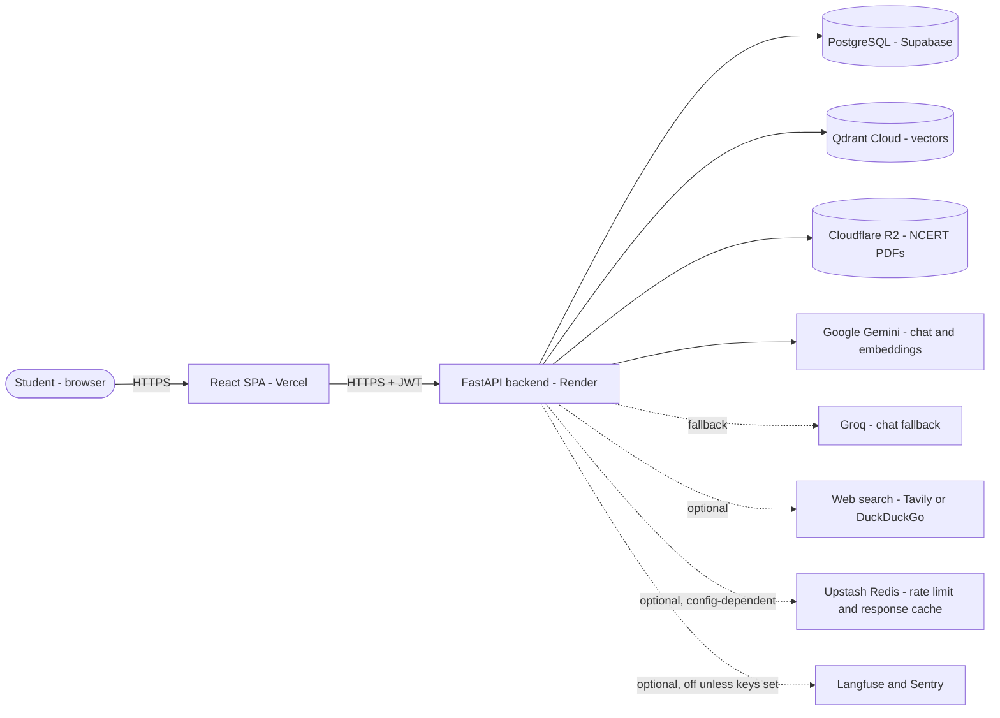
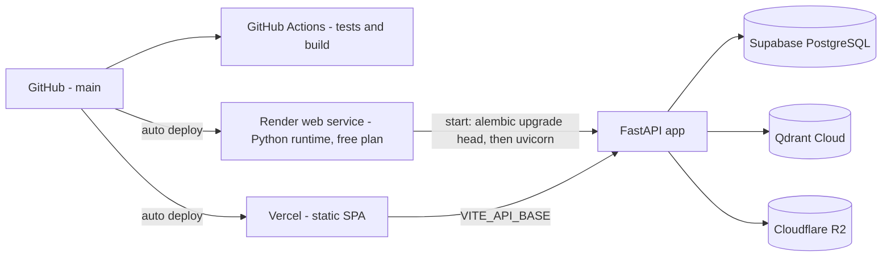
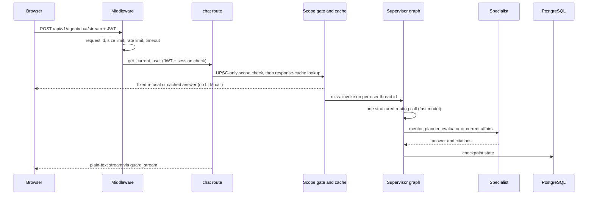

# Architecture

How UPSC AI Pro is put together, what each layer does, and where the trade-offs are. Every statement was checked against
the source on 2026-11-05. Evidence labels: **IMPLEMENTED** (in code), **ENABLED** (active in the default or documented
production configuration), **OFFLINE-TESTED**, **PRODUCTION-OBSERVED**, **PLANNED**, **UNVERIFIED**. See
[ENGINEERING_METRICS.md](ENGINEERING_METRICS.md) for how numbers were obtained.

> Note: the older root-level [`ARCHITECTURE.md`](../ARCHITECTURE.md) is kept for history. This file is the maintained
> overview; [AGENT_ARCHITECTURE.md](AGENT_ARCHITECTURE.md), [RAG_AND_RETRIEVAL.md](RAG_AND_RETRIEVAL.md) and
> [SECURITY.md](SECURITY.md) go deeper.

## 1. System context

Solid lines are required for the core product. Dashed lines are optional or fail-open: the application starts and keeps
serving when they are absent or failing. Qdrant and at least one LLM provider are **required** for retrieval-backed answers.

## 2. Frontend (`frontend/`)
- **Stack (IMPLEMENTED):** React 18, TypeScript, Vite, React Router, TanStack Query, Tailwind CSS, `react-markdown` with
  `rehype-sanitize`, Recharts.
- **Structure:** `main.tsx` → `App.tsx` (public routes) → `pages/AppLayout.tsx` (lazy-loaded `/app/*` feature routes).
  One folder per feature in `src/features/` (mentor, ncert, pyq, evaluator, current_affairs, planner, lecture, upload, plus
  dashboard, history and three admin views: cost, experiments, monitoring).
- **Single API client:** `src/lib/api.ts` owns `request()` (auth header, one refresh on 401), `streamAgent()` (plain-text
  streams) and `pollJob()` (background jobs). Components never call `fetch` directly.
- **Rendering model output:** sanitized Markdown. Two components use `dangerouslySetInnerHTML` for study aids that are
  HTML-escaped server-side (`src/core/study_aids.py`).
- **Size:** 44 TS/TSX files, 7,663 physical lines (measured 2026-11-05). No frontend unit tests exist (**gap**).

## 3. Backend (`src/`)
| Layer | Location | Responsibility |
|---|---|---|
| HTTP | `src/api/routes/*.py` | Thin handlers: validate, authorize, call a function, shape the response |
| App wiring | `src/api/main.py` | Middleware, router registration, `/health`, error handler |
| Feature logic | `src/agents/<feature>/graph.py` | **Plain Python functions** (despite the file name) for NCERT, PYQ, evaluator, current affairs, planner, lecture, upload |
| LangGraph | `src/graph/` | Supervisor, mentor ReAct agent, planner/evaluator/current-affairs wrapper subgraphs, memory |
| Shared services | `src/core/` | LLM factory, vector store, retrieval, grounding, DB, jobs, prompt safety, rate limiting, cache |
| Contracts | `src/schemas.py` | Pydantic request/response models and size limits |

Size, measured 2026-11-05: 113 Python modules and 20,185 physical lines excluding `src/eval/`.

### Middleware order (outermost → innermost)
`RequestId → HttpMetrics → MaxUploadSize → RateLimit → Timeout(90 s) → SecurityHeaders → CORS`. The request ID is
outermost so every inner log line and the response carry the same correlation ID. IMPLEMENTED; behaviour covered by
OFFLINE-TESTED unit and integration tests.

## 4. API layer
- Prefix `/api/v1`; OpenAPI at `/docs` and `/redoc`; `GET /health` is a static liveness response.
- **54** REST operations under `/api/v1` (56 including `/` and `/health`), measured from `app.openapi()`.
- Only the auth router is public. Every other router is registered under `_protected_routers` with
  `Depends(get_current_user)`. Details: [API_OVERVIEW.md](API_OVERVIEW.md).

## 5. LLM provider layer (`src/core/llm.py`)
- **Primary:** Google Gemini `gemini-2.5-flash` (main) and `gemini-2.5-flash-lite` (fast; used by the supervisor router).
- **Fallback:** Groq `llama-3.3-70b-versatile` / `llama-3.1-8b-instant` via LangChain `with_fallbacks`
  (`ENABLE_PROVIDER_FALLBACK=true`, set in `render.yaml`).
- Per-call timeout 45 s (`LLM_REQUEST_TIMEOUT_SECONDS`), `max_retries=1`, 4,096 output tokens. A timeout ends the request
  and does not cascade to another provider. Provider quota behaviour in production is UNVERIFIED.
- Optional Langfuse tracing exists (`src/core/observability.py`); whether production keys are configured is UNVERIFIED.

## 6. Retrieval layer
Chunk → embed (Gemini, 768-d) → Qdrant collection per `persist_key` → dense search → lexical re-scoring → RRF → threshold.
Full detail, including what is disabled, in [RAG_AND_RETRIEVAL.md](RAG_AND_RETRIEVAL.md).

## 7. Persistence
- **PostgreSQL (Supabase, ENABLED in production per `render.yaml` + owner report):** SQLAlchemy models for users,
  conversations, messages, feedback, auth tokens, background jobs, study plans and evaluation attempts; Alembic revisions
  0001–0006. SQLite is used locally and in tests.
- **LangGraph checkpointer and store:** `PostgresSaver`/`PostgresStore` when `DATABASE_URL` is PostgreSQL; otherwise a
  SQLite checkpointer plus an **in-memory** store (long-term student profile is then lost on restart). These tables are
  created at runtime, outside Alembic.
- **Qdrant:** remote server (`QDRANT_URL`) or embedded local path (`QDRANT_PATH`, single process). Required.
- **Cloudflare R2:** private bucket holding NCERT PDFs, read server-side with boto3 (`src/core/ncert_storage.py`).
  Without R2 or local PDFs the NCERT library is empty.

## 8. Background jobs (`src/core/job_queue.py`)
In-process `ThreadPoolExecutor` (default 2 workers). Job **status and result** are stored in the `jobs` table; the **work
itself is not durable** — inputs live in memory, so a job whose process dies ends in `error` and the user retries. A heartbeat
lease (30 s tick, 120 s lease) lets sibling workers fail only genuinely stale jobs. Transient-only retries, a 900 s
deadline, graceful shutdown. There is **no Redis/RQ/Celery** job system. Used by PDF upload, lecture processing and
PYQ-bank upload. OFFLINE-TESTED and benchmarked offline on SQLite (`scripts/bench_jobs.py`); behaviour on Postgres with
several workers is UNVERIFIED.

## 9. Authentication and authorization
JWT (HS256, 30-minute access token) with a per-request database check of the session id; opaque, hashed, rotating refresh
tokens; every user-owned query and vector key scoped by the authenticated user id. See [SECURITY.md](SECURITY.md).

## 10. External service dependencies
| Service | Required? | Used for |
|---|---|---|
| Google Gemini API | Yes (or Groq for chat) | Chat, structured routing, embeddings |
| Groq API | Optional fallback | Chat fallback |
| Qdrant | **Yes** for retrieval workflows | Vector search |
| PostgreSQL | Yes in production | Application data, checkpoints |
| Cloudflare R2 | For NCERT library | NCERT PDFs |
| Tavily / DuckDuckGo (`ddgs`) | Optional | Mentor `web_search`, current affairs |
| Upstash Redis | Optional | Distributed rate limit, response cache; **not set in `render.yaml`**, so production use is UNVERIFIED |
| Langfuse, Sentry | Optional | Tracing, error capture. Sentry code exists but is **not activated** (no DSN set; extra privacy hardening is unpublished Phase 09 work); Langfuse activation UNVERIFIED |
| YouTube (yt-dlp) | For lecture URLs | Transcripts |

## 11. Deployment architecture

Details and verification steps: [DEPLOYMENT.md](DEPLOYMENT.md). Auto-deploy wiring is a platform setting, not stored in this
repository (UNVERIFIED here).

## 12. Request flow (AI Mentor)

The other seven workflows skip the supervisor: their route handler calls a feature function directly
([WORKFLOWS.md](WORKFLOWS.md)).

## 13. Known architectural trade-offs
| Decision | Benefit | Cost / limitation |
|---|---|---|
| Plain feature functions instead of graphs for 7 workflows | Simple, testable, no shared-state coupling | No common orchestration, tracing or checkpointing for them |
| LLM router per mentor message | Correct specialist per message (fixed a stuck-route bug) | One extra fast-model call per message; real latency/cost UNVERIFIED |
| Thread-pool job queue, DB-persisted status | Zero extra infrastructure on a free tier | Work is not resumable; scale-out beyond a few workers is unproven |
| Mentor answers delivered whole, not token-by-token | Nested subgraphs are simpler | The user waits for the full generation (known backlog item) |
| Qdrant required, no working fallback | One vector path to test | A Chroma fallback is coded but its dependency is not installed |
| Render free plan | No cost | Cold starts after idle; limited memory |
| Tokens in browser `localStorage` | Simple SPA auth | Larger XSS blast radius (known risk) |
| In-memory LangGraph store when DB is not PostgreSQL | Works locally | Profile memory lost on restart in that mode |
