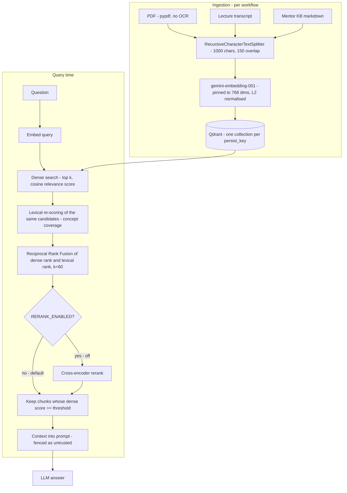

# RAG and retrieval

How documents become searchable context, which retrieval steps actually run, and what is implemented but switched off.
Verified against source on 2026-11-05. Labels follow [ARCHITECTURE.md](ARCHITECTURE.md): IMPLEMENTED, ENABLED,
OFFLINE-TESTED, PRODUCTION-OBSERVED, PLANNED, UNVERIFIED.

## Pipeline

## Components

| Item | Value | Source | Status |
|---|---|---|---|
| Embedding model | `models/gemini-embedding-001` via `langchain-google-genai` | `src/core/config.py:embedding_model` | ENABLED |
| Embedding dimension | **768**, enforced by `_DimPinnedEmbeddings`, which requests the dimension and also Matryoshka-truncates and L2-normalizes every vector, because the LangChain constructor argument silently did not apply | `src/core/vector_store.py`, `gemini_embedding_dim` | ENABLED, OFFLINE-TESTED |
| Chunking | `RecursiveCharacterTextSplitter`, 1,000 characters, 150 overlap | `get_text_splitter()`, `chunk_size`, `chunk_overlap` | ENABLED |
| Vector database | Qdrant (`QDRANT_URL` server, or `QDRANT_PATH` embedded) | `src/core/vector_store.py` | ENABLED (required) |
| Dense retrieval | Qdrant similarity with relevance scores | `gather_scored_documents` | ENABLED |
| Lexical stage | Concept-coverage score of each **dense candidate** against the query, with a curated UPSC abbreviation/synonym expansion | `src/core/retrieval.py:concept_coverage_score` | ENABLED |
| Fusion | Reciprocal Rank Fusion, `score = Σ 1/(k+rank)`, **k = 60**, over the dense and lexical rankings of the same candidates | `retrieval.py:reciprocal_rank_fusion`, `DEFAULT_RRF_K` | ENABLED, OFFLINE-TESTED |
| Relevance threshold | `SIMILARITY_THRESHOLD` = **0.3** (shared pipeline); `MENTOR_KB_THRESHOLD` = **0.25** (mentor KB). Both also set in `render.yaml`. Applied to the **dense** score, not the RRF score | `vector_store.py`, `mentor_kb.py` | ENABLED |
| Response cache | Exact (SHA-256 of normalised question) + semantic (cosine ≥ **0.92**), TTL **24 h**, scoped per user and thread; **mentor chat only** | `src/core/response_cache.py`, `routes/chat.py` | IMPLEMENTED; **production use UNVERIFIED** (needs Upstash credentials, which `render.yaml` does not set) |

### What "lexical" means here
There is **no BM25 index and no separate lexical retriever**. After the dense search returns *k* candidates, each is scored
for how many of the query's concepts it covers, and that ranking is fused with the dense ranking by RRF. The lexical stage
can **re-order** dense hits; it cannot surface a document the dense search missed. `retrieval.py` and the backlog both state
this; do not describe it as "hybrid search".

### Per-workflow retrieval settings
| Workflow | Function | k | Threshold | Lexical + RRF | Collection key |
|---|---|---|---|---|---|
| AI Mentor (`knowledge_base_search`) | `mentor_kb.search_kb` | 4 | 0.25 | **No — dense only** | global mentor KB |
| NCERT Study | `similarity_search_with_sources` | 5 | 0.3 | Yes | global, allow-listed `ncert_*` |
| PDF / Document Chat | `similarity_search` | 5 | 0.3 | Yes | `upload_<user id>_<md5>` |
| Lecture Learning | `similarity_search` | 5 | 0.3 | Yes | `lecture_<user id>_paste_<id>` (pasted) or global YouTube id |
| PYQ bank | `similarity_search` | 8 | 0.3 | Yes | `pyqbank_<user id>` |

## Collection strategy and ownership
- One Qdrant collection per `persist_key`, built **server-side** (`make_persist_key` and the per-feature key helpers).
- User-owned collections embed the owner's id from the JWT. Client-sent ids are validated by format (`PDF_HASH_PATTERN`,
  `VIDEO_ID_PATTERN`). The model-facing tool can only search the mentor KB. Legacy keys without an owner are never read (ADR-007).
- Global corpora: mentor KB, NCERT, YouTube lecture transcripts.
- Metadata kept on chunks (source title/filename, chapter, page) is used for source labels; the NCERT chunks also carry the
  class/subject/chapter.

## Citations
Citation behaviour **differs by workflow** and is not universal.

| Workflow | What the user sees | How it is produced | What is validated |
|---|---|---|---|
| AI Mentor | "Sources used" block: numbered web sources and knowledge-base sources | Built from tool-call artifacts (`src/core/grounding.py`); KB citations filtered by token overlap with the answer | Numbers cited in the answer are matched to retrieved sources; **no claim-level verification** |
| NCERT Study | `[S1]`, `[S2]` tags in the answer plus a footer listing the cited excerpts | The prompt numbers retrieved excerpts; `source_footer` lists the ones the answer cites and warns when none is cited | **Format only**: a `[S#]` tag must match a retrieved source. It cannot prove the cited text supports the sentence |
| PDF chat, Lecture chat, PYQ bank | Grounded answers from retrieved context; no structured citation block | — | The "nothing relevant found" path when no chunk clears the threshold |
| Evaluator, Planner, Current Affairs page | Not retrieval-cited | Current Affairs states its feed sources (PIB, The Hindu, Indian Express, Down To Earth) in a fixed note | — |

`compose_grounded_answer` exists in `grounding.py` but is **never called**; citations are formatted, not enforced.

## Disabled or experimental capabilities
| Capability | Flag (default) | Status |
|---|---|---|
| Cross-encoder reranking | `RERANK_ENABLED=false` | IMPLEMENTED, **disabled**. The `local` provider needs `sentence-transformers` (not a dependency); `cohere` needs a key |
| Multi-query expansion | `MULTI_QUERY_ENABLED=false` | IMPLEMENTED, **disabled** |
| HyDE | `HYDE_ENABLED=false` | IMPLEMENTED, **disabled** |
| Chroma fallback | — | Coded but `langchain_chroma` is not installed; **not a working fallback**. Qdrant is required |
| CRAG graph (`src/graph/rag_graph.py`) | — | Not reachable over HTTP; used only by `src/eval/llm_eval.py` |
| Separate BM25 / sparse index | — | **Does not exist** |

Phase 06 decided (ADR-015) to leave all of these and the production ranking unchanged, because measured headroom was tiny
on the available data.

## Measured retrieval quality (and why not to over-read it)
From the offline benchmark `scripts/bench_retrieval.py` (details and limits in
[ENGINEERING_METRICS.md](ENGINEERING_METRICS.md#retrieval-quality-benchmark-phase-06-stage-1-baseline)):
- 97 queries (84 answerable, 13 unanswerable) over four labelled corpora; three corpora are synthetic and small (11–61 chunks).
- Labels and questions were written by an AI assistant and are `human_verified: false`.
- Pooled production Recall@k 0.988, MRR@k 0.935 — a **ceiling effect** on easy data, not evidence of production quality.
- **Threshold finding:** top-1 similarity scores on this embedding model fall between 0.75 and 0.90 for both answerable and
  unanswerable queries, so thresholds of 0.3 / 0.25 filter nothing: **13 of 13 unanswerable queries still retrieved context**.
  The "nothing relevant found" guards therefore rarely fire. This is a documented, unfixed limitation (calibration needs a
  larger held-out set).
- NCERT, real user uploads and production Qdrant collections were **not measured**.

## Limitations
- Retrieval quality on real student questions and production collections is UNVERIFIED.
- Scanned PDFs are unsupported (no OCR).
- The 24-hour semantic cache can serve a stale answer to a time-sensitive mentor question.
- Qdrant is a hard dependency; there is no working local fallback.
- A partially indexed upload is not repaired on retry (backlog).
